# 車輛銷售管理系統｜使用說明

> 本檔由 `sales/help/articles.py` 自動產生，請勿直接修改；改文章後執行 `python manage.py build_user_manual`。
> 系統內的「使用說明」（/help/）與本檔內容相同；截圖用合成資料產生，不含真實客戶。

## 目錄

- [從這裡開始](#從這裡開始)
- 剛開始用（登入、首頁、看不懂的訊息與名詞）
  - 1. 第一次登入與畫面入口
  - 2. 首頁、常用功能與公告
  - 3. 畫面出現看不懂的訊息
  - 4. 名詞表
  - 5. 個資與帳號安全
- 每天會用（接單、配車、領牌、交車與收款）
  - 6. 建立訂單
  - 7. 拍證件與核對資料
  - 8. 找一張訂單
  - 9. 讓客人簽訂購單
  - 10. 建立後修改訂單
  - 11. 配車
  - 12. 領牌
  - 13. 交車並收尾款
  - 14. 收訂金與登記收款
  - 15. 看營運總表
- 偶爾用（車行結算、補助、取消、對帳與庫存）
  - 16. 車行傭金與台數獎金
  - 17. 套表列印
  - 18. 汰舊與補助
  - 19. 一台車用多種付款
  - 20. 接續或刪除草稿
  - 21. 整理一張訂單的收支
  - 22. 取消、退款與沒收
  - 23. 補齊文件、結案
  - 24. 報表中心：查一段期間的車行排行
  - 25. 分期與平台撥款對帳
  - 26. 進車、調車與現有台數
  - 27. 下單改價、贈品與自訂分期
  - 28. 刪除訂單與還原
  - 29. 價格表分發與年節送禮
- 設定與管理（主檔、權限與系統設定）
  - 30. 機種、售價與年式
  - 31. 配件與工資
  - 32. 車行傭金、獎勵活動與台數獎金設定
  - 33. 車行、網路平台與本店人員
  - 34. 帳號與權限
  - 35. 分期方案、領牌費用與假日
  - 36. 原廠獎勵與補助方案
  - 37. 選車展示與車色圖片
  - 38. 原廠車型比對
  - 39. 建立與修改報表
  - 40. 列印範本與公司抬頭
  - 41. 舊資料 Excel 匯入
  - 42. 系統狀態、公告與說明文字
  - 43. 系統清空後重建資料

## 從這裡開始

第一次接單，照這幾站走一遍：

1. **建立訂單**（第 6 篇）：選車、填車主、選分期與選號、收訂金。
   - 範例：SUI 125 消光黑、分期 24 期、訂金 3,000 → 分期外應收 4,400
2. **配車**（第 11 篇）：打開訂單，系統已預選一台符合的車，確認就好。
   - 範例：預選 DEMOE 開頭的消光黑，按「確認配車並鎖定」。
3. **領牌**（第 12 篇）：填實際領牌日與車牌，按「確認完成」，再按「確認完成並鎖定」。
   - 範例：2026/11/16、ABC-1234；牌險規費 1,364 照列支出（分期單本店吸收）。
4. **交車並收尾款**（第 13 篇）：看「應收怎麼算」，填實收，按「收尾款並完成交車」。
   - 範例：總價 80,400－分期撥款 76,000－訂金 3,000＝**應收 1,400**。
5. **套表列印**（第 17 篇）：一次印信封、簽收單與身分證影本。
   - 範例：勾王小明那一列 → 預覽 → 信封下載 Word、其他開 A4 PDF。
6. **補齊文件、結案**（第 23 篇）：補助與文件都處理完後，在「取消與結案」確認結案。
   - 範例：沒有補助，直接確認結案，移到「已結案」。

# 剛開始用

登入、首頁、看不懂的訊息與名詞

## 1. 第一次登入與畫面入口

**什麼時候用**：第一次拿到帳號，或想知道密碼、配色、使用說明在哪裡時。

_約 3 分鐘・5 個步驟_

### 範例

新同仁**示範業務**（合成資料）拿到 admin 開的帳號與臨時密碼，第一次登入。

- 帳號：demo.sales
- 臨時密碼：admin 當面告知，第一次登入後要改掉

### 怎麼做

1. 在登入頁輸入「帳號」與「密碼」，按「登入」。看不清楚打了什麼，可以按密碼欄旁的「顯示」。
   - 範例：帳號 demo.sales。畫面出現「大寫鎖定已開啟」時，先關掉大寫鎖定。

   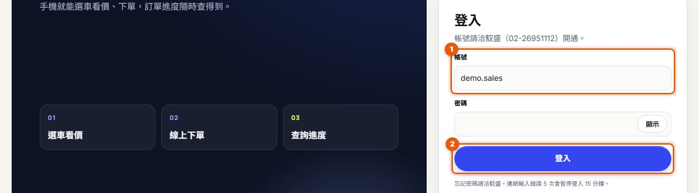
   _① 帳號與密碼　② 登入_

2. 第一次登入或密碼剛被重設，會先看到「首次登入，請先設定新密碼」：填「目前密碼」、「新密碼」、「再次輸入新密碼」，按「儲存新密碼並繼續」。
   - 範例：目前密碼填 admin 給的臨時密碼，新密碼至少 8 個字、不能全是數字。

3. 電腦版右上角按自己的姓名，選單裡有「外觀配色」、「使用說明」、「檢查更新」、「我的密碼」、「登出系統」。
   - 範例：使用說明會另開分頁，不會離開正在填的資料。

   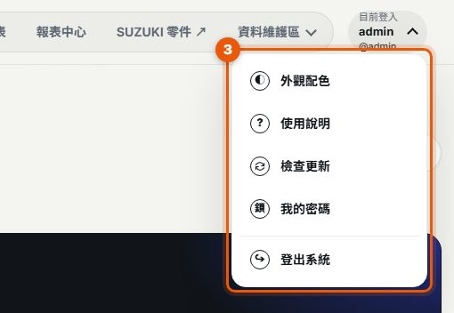
   _③ 帳號選單的五個項目_

4. 手機版看畫面最下方：首頁、＋建立訂單、全部訂單、營運、「更多」。配色、「變更密碼」、使用說明與「登出」在「更多」的最下面。

   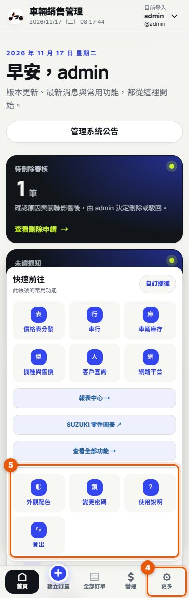
   _④ 更多　⑤ 配色、密碼、說明與登出_

5. 想換畫面顏色：選「外觀配色」，點一種配色先預覽，按「套用此配色」才會儲存；其他裝置登入也會套用。
   - 範例：選「夜間深墨」，晚上看比較不刺眼。

> 完成：登入後先到首頁，下一篇教你把常用的功能排在首頁。 下一步：首頁、常用功能與公告。

### 常見問題

**忘記密碼？**

畫面上沒有自助重設，請 admin 在「帳號與權限」按「重設密碼」，下次登入會要求你改新密碼。

**出現「登入失敗次數過多」？**

同一個帳號 15 分鐘內錯 5 次會暫停 15 分鐘；時間到再試，急件請找 admin。

**畫面跟同事的不一樣？**

看得到哪些功能依帳號權限而定；缺了需要的功能請 admin 開通。

**系統有新版本？**

系統每 5 分鐘自動檢查一次，有新版會提示重新載入；也可以在帳號選單按「檢查更新」。

**有幾種配色？**

墨黑群青（預設）、夜間深墨、跟隨裝置、沉穩深藍、石墨灰金、明亮靛藍、高對比。

### 規則細節

- 登入後 12 小時自動登出（不論有沒有在用）。
- 電腦版叫「我的密碼／登出系統」，手機版叫「變更密碼／登出」，是同一個功能。

相關：首頁、常用功能與公告、個資與帳號安全

## 2. 首頁、常用功能與公告

**什麼時候用**：想把每天要用的功能排到首頁、設定手機捷徑，或看系統公告與新版本時。

_約 3 分鐘・5 個步驟_

### 範例

示範業務（合成資料）每天都要開「我的接待草稿」和「套表列印」，想把它們排在首頁最前面。

### 怎麼做

1. 首頁由上往下：待辦（有待處理的才出現）、「常用功能」、公告與更新。按常用功能右上角的「編輯常用功能」。

   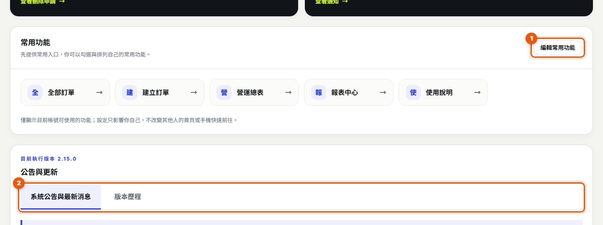
   _① 編輯常用功能　② 公告與版本歷程_

2. 勾選要放到首頁的功能；功能很多時用「搜尋功能」，或勾「只看已勾選」。
   - 範例：搜尋「草稿」，勾「我的接待草稿」。

   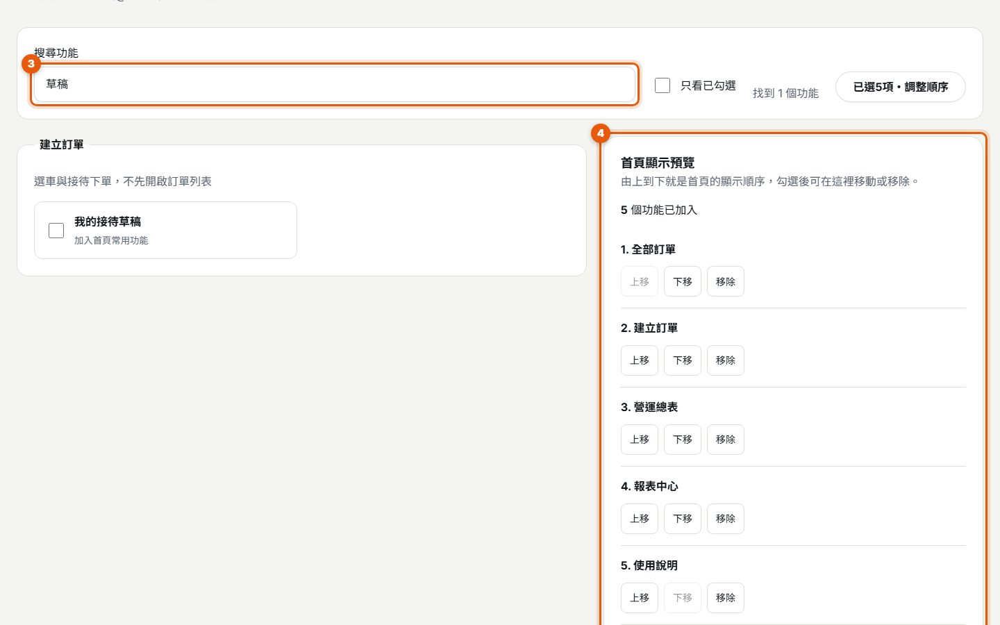
   _③ 搜尋與勾選　④ 首頁顯示預覽_

3. 在右邊「首頁顯示預覽」按「上移」、「下移」、「移除」排順序，最後按「儲存常用功能」。
   - 範例：把「我的接待草稿」上移到第一個。
   - 「恢復預設」「全部取消勾選」只改畫面上的草稿，按「儲存常用功能」才生效。

4. 手機：按下方「更多」→「自訂捷徑」，位置 1–6 各選一個功能，不用的選「不使用此位置」，按「儲存設定」。
   - 範例：位置 1 選「全部訂單」、位置 2 選「套表列印」。

   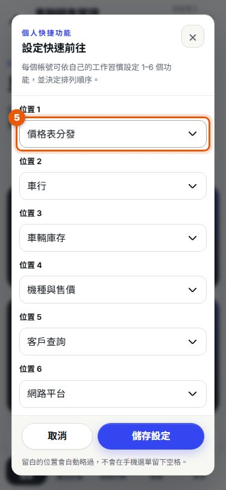
   _⑤ 位置 1–6_

5. 看公告：首頁「系統公告與最新消息」按「閱讀公告」看全文；切到「版本歷程」看最近兩版的新功能，按「查看完整版本歷程」看全部。

> 完成：首頁的常用功能跟著帳號走，換電腦或手機登入也一樣。

### 常見問題

**找不到「我的接待草稿」或「選車展示管理」？**

這兩個沒有其他入口，只能從「編輯常用功能」加到首頁（要有權限才看得到）。

**儲存時說「收藏已被另一個視窗更新」？**

另一個分頁先存過了；重新整理再改一次。

**手機捷徑存不起來？**

至少要留 1 個、最多 6 個，而且同一個功能不能選兩次。

**首頁有「待刪除審核」？**

有刪除審核權限才會出現，點進去處理同事送來的刪除申請。

### 規則細節

- 公告依「置頂 → 開始時間新到舊」排列，每頁 10 則。

相關：第一次登入與畫面入口、接續或刪除草稿

## 3. 畫面出現看不懂的訊息

**什麼時候用**：畫面出現錯誤頁、紅色提示，或按鈕按不下去、不知道下一步卡在哪裡時。

_約 2 分鐘・5 個步驟_

### 範例

示範客戶32（合成資料）的訂單還沒配車，業務想先交車，交車區卻列出「完成下列事項後就能交車」。

### 怎麼做

1. 出現「系統暫時無法完成這個動作」：記下頁面上的 **查修編號**（12 碼英數）和操作時間，告訴 admin。資料通常沒有存進去，稍後再試一次。

2. 出現「你目前不能執行這個操作」：帳號沒有這個畫面的權限，或資料已鎖定，請 admin 確認；「找不到你要開啟的頁面」：訂單可能已刪除或網址打錯，從全部訂單重新找。
   - 範例：示範業務打開「刪除審核」，因為只有 admin 能審核，出現這一頁。

   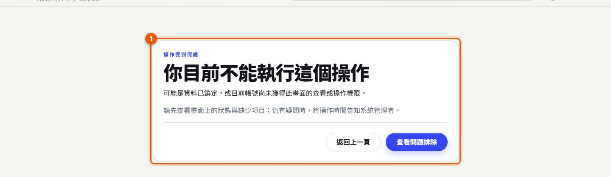
   _① 錯誤說明、返回上一頁與查看問題排除_

3. 畫面上方出現「目前沒有網路連線」：先別關頁面；訂單頁會等連線恢復後自動補存。

   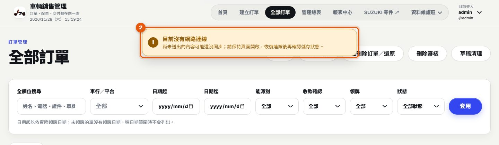
   _② 沒有網路連線_

4. 交車按不下去：看交車區的「完成下列事項後就能交車」，照清單補完。
   - 範例：示範客戶32 的清單第一項是「尚未配車」，先去配車。

   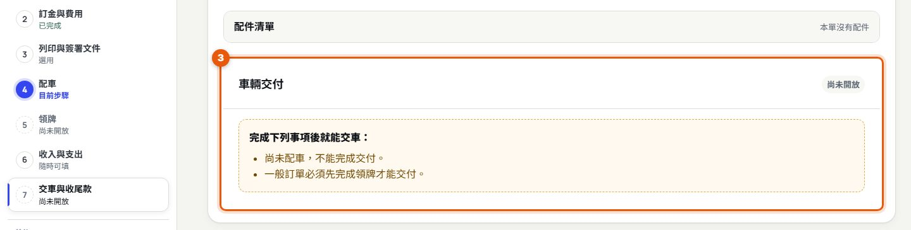
   _③ 還沒完成的事項_

5. 草稿顯示「○○ 正在編輯這筆草稿，目前只能查看」：請對方先離開；對方異常關閉時，90 秒後會自動解除。

> 完成：照著訊息處理還是不行，就把畫面截圖、查修編號與時間交給 admin。

### 常見問題

**交車清單可能出現哪些事項？**

尚未配車、一般訂單必須先完成領牌、折扣申請尚待確認、電動車須先勾選「車控與電池合約已確認」、尾款尚未收清、車行掛帳超過額度。

**正式訂單也會被別人鎖住嗎？**

不會；只有草稿會。訂單頁可以多人同時改，改到同一欄時會提示「此區有與剛才更新重疊的欄位，未覆寫您的輸入」。

**畫面寫「目前畫面為僅查看權限」？**

這個帳號只能看；新增、修改、刪除要 admin 另外開放。

**出現英文的 403 頁？**

畫面停太久後才送出，表單已過期；重新整理頁面再填一次。

**分期還沒核准可以交車嗎？**

可以；分期核准不是交車條件，撥款也是事後對帳。

相關：交車並收尾款、帳號與權限

## 4. 名詞表

**什麼時候用**：畫面上的用語看不懂，或同事講的詞跟畫面對不起來時。

_隨時查・6 個步驟_

### 範例

王小明（合成資料）的分期單：車價 76,000 由分期公司付，客人自己付的是**分期外應收** 4,400，訂金 3,000，交車時收**尾款** 1,400。

### 怎麼做

1. **訂單狀態**：「待配車」＝還沒指定哪一台車；「已交車／待結案」＝交車和領牌都完成，等人員按結案；「已交車／待領牌」＝先交車、還沒領牌；「取消待退款」＝已登記取消，還要結算沒收或退款；「例外結案（領牌後棄單）」＝已領牌但客人不要車。

   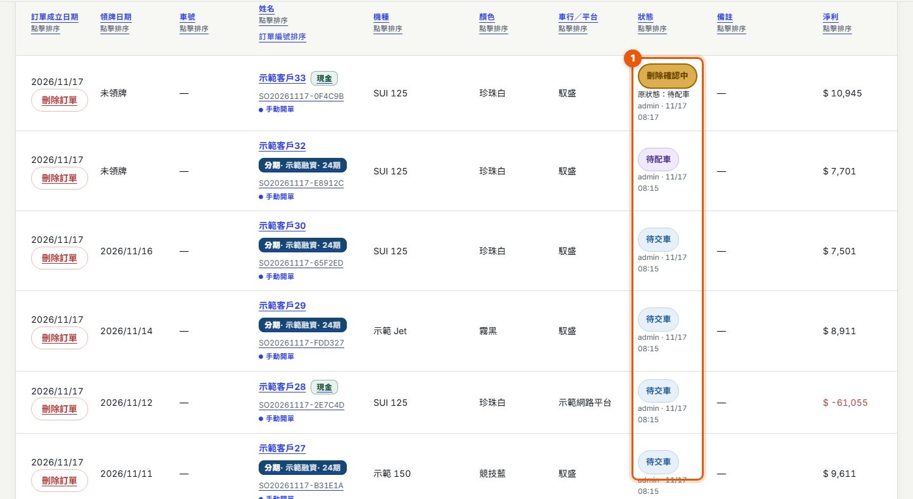
   _① 訂單狀態_

2. **客人的錢**：「分期外應收」＝分期以外客人自己要付的錢；「尾款」＝交車時還要收的錢；「已確認實收」＝已確認入帳的收款；「系統試算」＝系統先算的參考金額，可以再改。

3. **費用**：「牌險費」＝領牌稅金加強制險；「選號費」＝只有選號方式「指定號碼」才收；「牌險手續費」＝新單的代辦收入（舊 Excel 匯入的單叫「代辦費收入」）。

4. **車與領牌**：「優先配車」＝配車時排最前面的車（出廠超過一段時間會自動優先）；「預計」＝先填的領牌日或車牌，不列入報表；「確認完成並鎖定」＝領牌真的完成，鎖定成本、獎勵與傭金。

5. **車行與收支**：「抵扣應收」＝傭金直接從車行要付的車款扣掉；「另付」＝傭金另外付給車行；「台數獎金」＝依車行一段期間的台數自動算的獎金；「車行掛帳」＝車行還欠的款；「預估車價收入」＝分期撥款入帳前的估計，入帳後改成「實際車價收入」。

6. **其他**：「草稿」＝還沒正式建立、系統先存起來的訂單；「鎖定」＝重要步驟完成後避免被誤改；「交易類型」（一般新車、領牌車…）和「訂單來源」（本店、車行、平台）是兩件事，分開選。

### 常見問題

**「待結案」是一個狀態嗎？**

畫面上一定寫「已交車／待結案」，代表交車和領牌都完成、還沒按結案。

**「預估」什麼時候變「實際」？**

分期撥款在「統一撥款對帳」登記入帳後，車價收入就從預估改成實際並鎖定。

**優先配車是超過幾個月？**

預設出廠超過 3 個月，admin 可以在配車規則調整。

相關：整理一張訂單的收支、車行傭金與台數獎金

## 5. 個資與帳號安全

**什麼時候用**：設定密碼、在共用電腦上用系統，或要查看車控密碼、匯款帳號這類敏感資料時。

_約 2 分鐘・4 個步驟_

### 範例

示範業務（合成資料）在店裡的共用電腦接完王小明的單，下班前要確定別人不能用他的帳號。

### 怎麼做

1. 密碼至少 8 個字，不能全是數字、不能跟姓名或帳號太像、不能是常見密碼。要改密碼：帳號選單 →「我的密碼」。
   - 範例：不要用 12345678 或自己的帳號當密碼。

   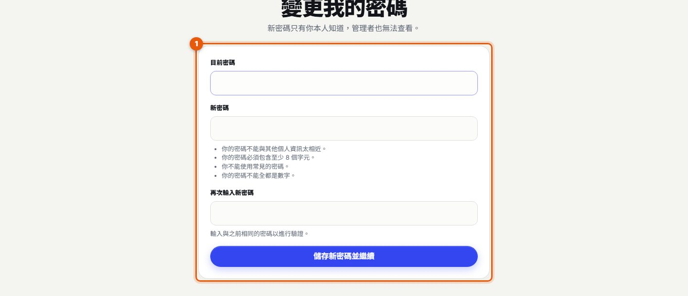
   _① 目前密碼與新密碼_

2. 離開共用電腦前一定要按「登出系統」（手機是「更多」→「登出」）。關掉瀏覽器**不會**自動登出。
   - 範例：下班前在右上角姓名選單按「登出系統」。

3. 車控密碼、電池密碼平常不顯示，按「查看已存車控密碼」才會出現；每看一次都會在處理紀錄留一筆「查看車控密碼」。

4. 看到不認得的登入或資料被改，請記下時間告訴 admin；訂單的處理紀錄會留下誰在什麼時候改了什麼。

> 完成：自己的帳號只自己用，不借給同事；同事需要功能請 admin 開通。

### 常見問題

**登入一直錯被暫停？**

同一個帳號在同一個地方 15 分鐘內錯 5 次，或 1 小時內在任何地方錯 20 次，都會暫停 15 分鐘。畫面上沒有解除按鈕，時間到再試。

**admin 重設我的密碼後？**

你所有裝置都會被登出；下次登入要先設定新密碼。

**多久會自動登出？**

登入後 12 小時，不論有沒有在用。

**身分證照片可以傳給別人嗎？**

不行。需要影本請用「套表列印」印身分證影本，不要用通訊軟體傳照片。

### 規則細節

- 系統只在畫面上顯示做事需要的個資；匯出與列印都依帳號權限。

相關：第一次登入與畫面入口、帳號與權限

# 每天會用

接單、配車、領牌、交車與收款

## 6. 建立訂單

**什麼時候用**：客人決定買車、要留下訂單時。

_第一次約 15–20 分鐘，熟了約 5 分鐘・7 個步驟_

### 範例

客人**王小明**（合成資料）要買 SUI 125 消光黑，分期 24 期、想選號 8899、加裝後箱，今天先付現金訂金 3,000。

- 車價（分期總價）：76,000，系統帶入
- 分期：示範融資 24 期 × 3,500，開辦費 1,500
- 牌險費：留空＝不向客人收（分期單本店吸收）
- 選號：指定號碼 8899、9988，選號費 1,200
- 加購：示範後箱 1,500＋工資 200
- 訂金：現金 3,000

系統會算出：

- **分期外應收 4,400**＝牌險 0＋選號 1,200＋配件 1,700＋開辦費 1,500
- **交車時尾款 1,400**＝4,400－訂金 3,000

### 怎麼做

開始前：先在「全部訂單」搜尋客人姓名或電話，確定沒有重複的單。

1. 按頁首「建立訂單」，在要的車色卡上按「選這台接單」。
   - 範例：SUI 125 消光黑那張卡。

   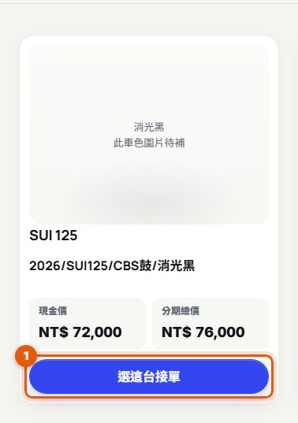
   _① 選這台接單_

2. **車款與車價**：選訂單來源，付款方式改成「分期」，再選分期公司與期數。分期單的牌險費留空就好。
   - 範例：本店、分期、示範融資 24 期 · 每期 $3,500。車價自動帶入 76,000，開辦費帶入 1,500。

   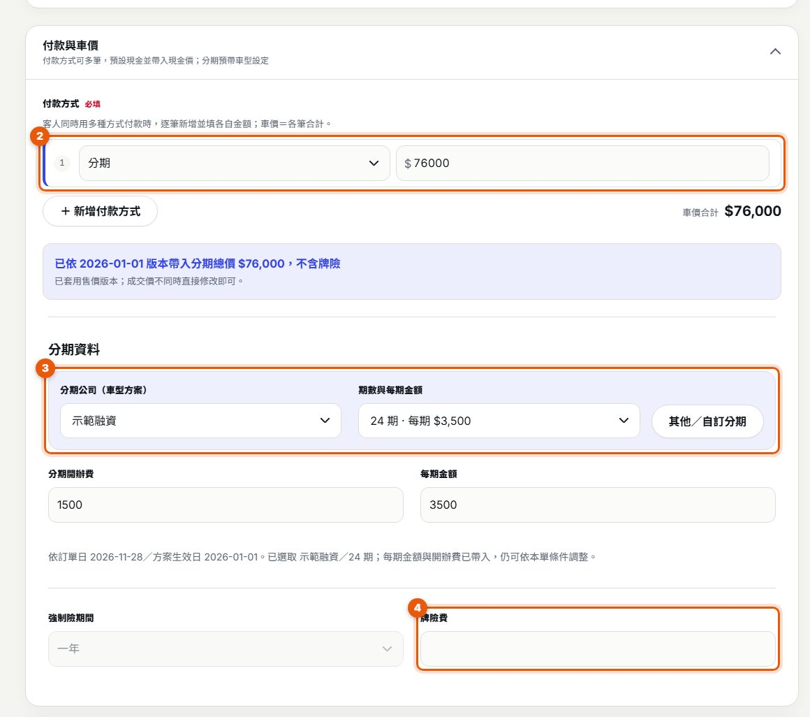
   _② 付款方式　③ 分期公司與期數　④ 牌險費（分期單留空）_

3. **車主與證件**：拍證件正反面，等出現「辨識完成，請核對資料」，逐欄對照照片。
   - 範例：帶入王小明、A123456789、1990/05/12。照片會自動裁切、轉正。
   - 核對無誤後，勾最下面的「已人工核對證件」。

   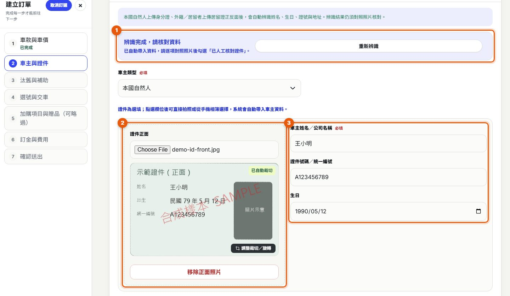
   _① 辨識完成　② 裁切後的證件（點它可以調整）　③ 對照這三欄_

4. **汰舊與補助、選號與交車**：有補助就勾；再選選號方式與交車方式。
   - 範例：沒有補助直接下一步；選號「指定號碼」、選號費 1,200、號碼 8899、9988；交車「客人來店取車」。

   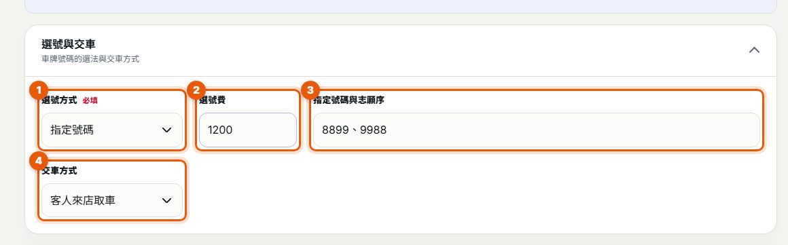
   _① 選號方式　② 選號費　③ 指定號碼　④ 交車方式_

5. **加購項目與贈品**：選配件，售價與工資會自動帶入；沒有就直接按「下一步」。
   - 範例：示範後箱，帶入 1,500＋200，單件總額 1,700。

   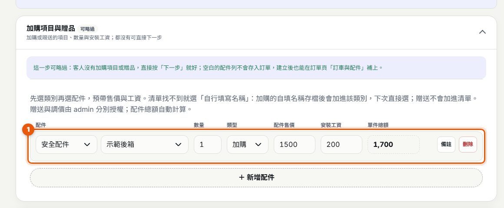
   _① 一個配件一列_

6. **訂金與費用**：把「目前金額」給客人看，再填這次實收的訂金、日期與付款方式。
   - 範例：目前金額顯示分期外應收 **4,400 元**；訂金 3,000、現金。

   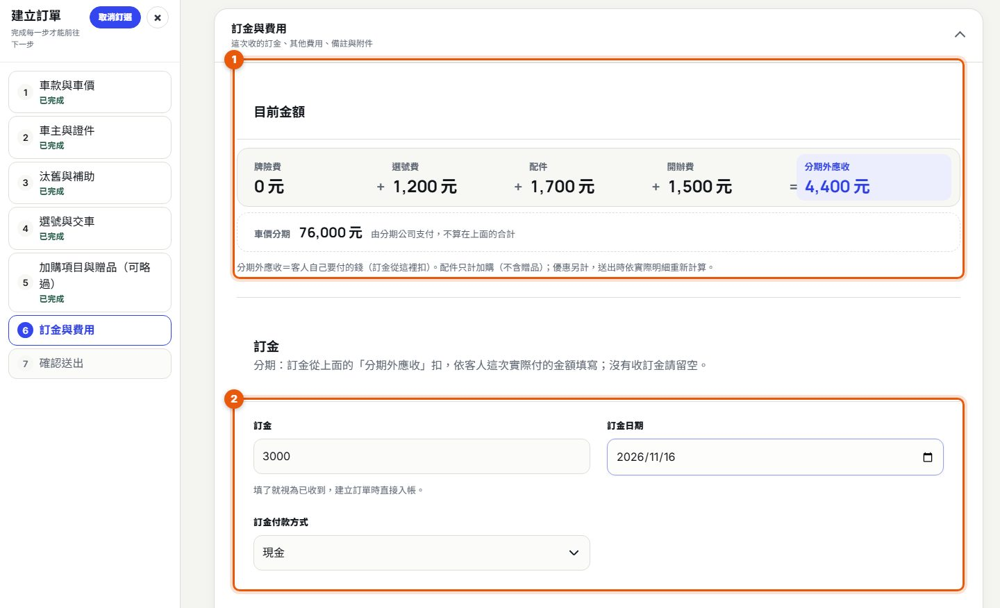
   _① 目前金額（客人要自己付的錢）　② 訂金_

7. **確認送出**：核對摘要，按「確認並建立訂單」，接著選簽署方式。
   - 範例：出現「訂單已成立」，狀態「待配車」。

   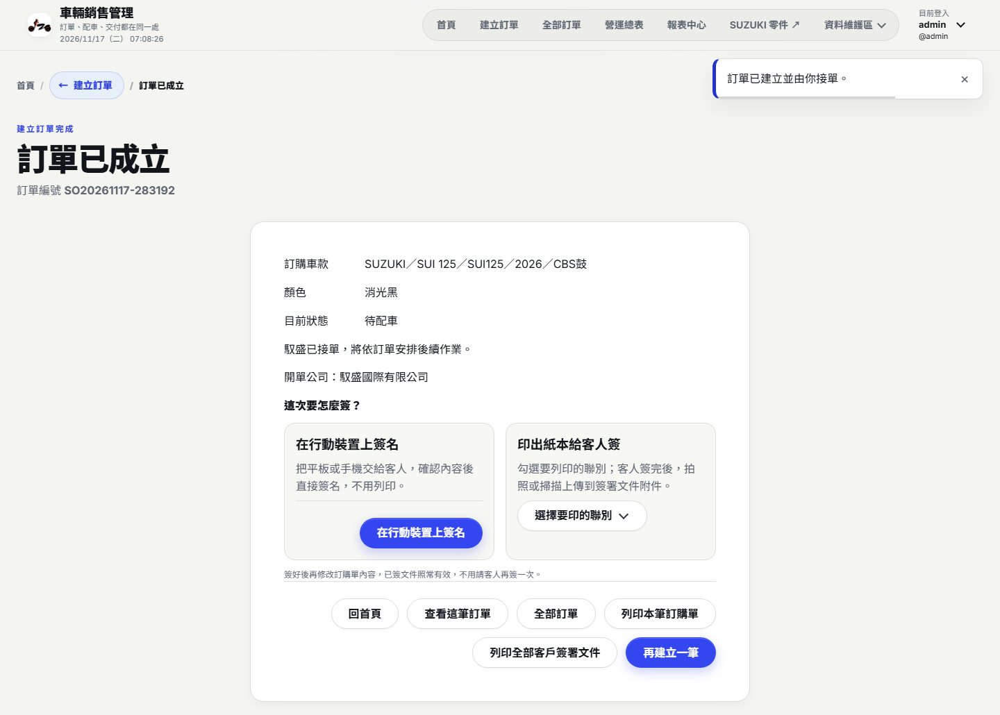
   _訂單已成立：選「在行動裝置上簽名」或「印出紙本給客人簽」_

> 完成：訂單進入「待配車」，你就是接單人。 下一步：配車。

### 常見問題

**按「下一步」卻停在原地？**

畫面上方「這一步還有資料需要處理」會列出缺什麼，補齊再按。前面沒完成的步驟不能跳過。

**證件轉歪、裁到邊，或標「建議確認裁切」？**

點證件卡片打開調整視窗，拖四個角或按「向左／向右轉 90°」；上下顛倒按「轉 180°」，再按「套用」。照片太暗或模糊，可以拉「亮度」「清晰度」。

**牌險費要填多少？**

分期單留空就不向客人收，牌險由本店吸收；客人或車行確實要付時才填金額。現金單留空＝照系統試算向客人收，填 0＝不收。

**填到一半客人要走？**

每按一次「下一步」都會存草稿，之後從「我的接待草稿」按「繼續本筆下單」，會回到沒完成的那一步。

**看不到「選這台接單」？**

帳號只有瀏覽權限，按鈕會變成「查看車款與分期」。請 admin 開通。

### 規則細節

- 分期外應收＝客人自己要付的錢：牌險費＋選號費＋配件（只算加購）＋分期開辦費＋其他費用；分期公司付的車價另列一行。
- 訂金填了就當作已收到，建立訂單時直接入帳；不能超過總價（扣掉優惠後），分期單只提醒、不擋。
- 只有選號方式「指定號碼」收選號費。
- 交易類型（一般新車、領牌車、試乘車、中獎車、中古車交易、其他）和訂單來源是兩件事，分開選。
- 訂購單與個資同意書一律使用本店公司資料。

## 7. 拍證件與核對資料

**什麼時候用**：建立訂單第 2 步要帶入車主資料，或證件照片轉歪、裁到邊時。

_約 2 分鐘・5 個步驟_

### 範例

王小明（合成資料）的身分證正反面，拍照時有點歪。

- 車主類型：本國自然人
- 帶入結果：王小明、A123456789、1990/05/12、示範市中正區示範路100號

### 怎麼做

1. 在 **車主與證件** 先選「車主類型」，再點「證件正面」「證件反面」拍照或選圖。每上傳一面，照片會馬上自動裁切、轉正。
   - 範例：卡片右上角出現「已自動裁切」。

2. 正反兩面都有照片後會自動辨識；出現「辨識完成，請核對資料」，姓名、證號、生日、地址會自動帶入。辨識中可以先填電話。
   - 範例：帶入王小明、A123456789、1990/05/12。

   
   _① 辨識完成　② 裁切後的卡片　③ 對照這三欄_

3. 逐欄對照照片：正面看姓名、證號、生日，反面看地址（巷、弄、樓）。有錯直接改。

4. 卡片轉歪、裁到邊或標「建議確認裁切」時，點卡片打開「調整裁切／旋轉」：拖四個角對齊卡片，或按「向左轉 90°」／「向右轉 90°」，上下顛倒按「轉 180°」，再按「套用」。
   - 範例：也可以按「自動偵測」重新找卡片，或「使用整張圖片」不裁切。照片太暗或模糊，拉「影像」的亮度（-50～+50）和清晰度（0～100），裁切後預覽和列印都會跟著變；原始照片不會被改。

   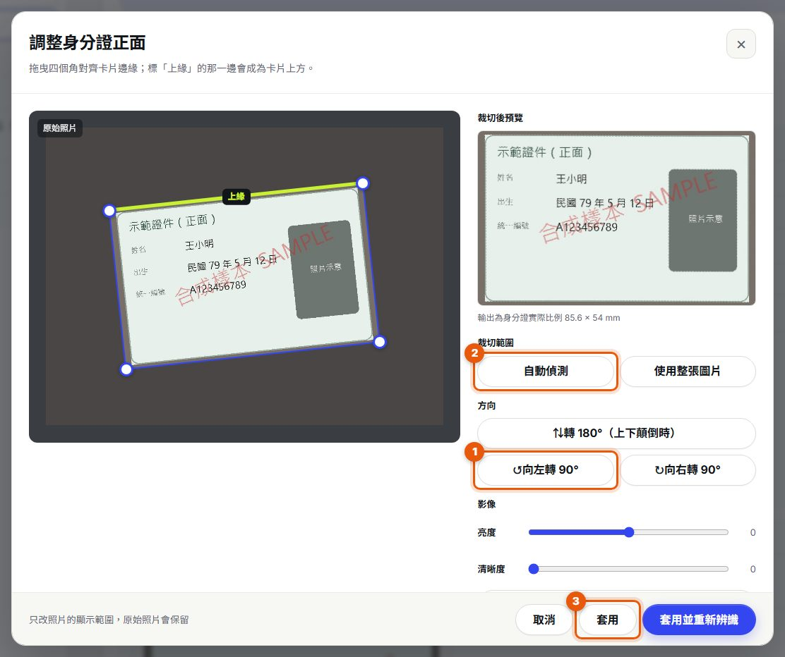
   _① 旋轉　② 自動偵測　③ 套用_

5. 核對完勾「已人工核對證件」，按「下一步」。

   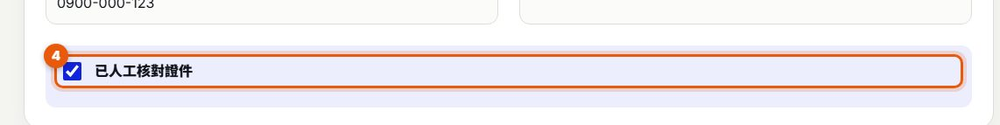
   _④ 已人工核對證件_

> 完成：車主資料存進草稿；原始照片完整保留，裁切只影響顯示與辨識。 下一步：建立訂單。

### 常見問題

**一定要拍證件嗎？**

證件是選填，「下一步」不會被辨識擋住；但有拍的話一定要逐欄核對。

**「建議確認裁切」是什麼？**

系統對自動裁切沒把握時才會標：找不到卡片邊緣、比例差很多、卡片太小、看不出上下方向，或裁切後辨識不到。打開調整視窗按「套用」後提醒就消失。

**「套用並重新辨識」什麼時候用？**

調整後想用新的裁切重新辨識時。要兩面都有照片才會出現；重新辨識不會覆蓋你已經填好的欄位。

**訂單建立後要換證件？**

到訂單「訂車與配件」最下方的「新車主資料」，按「更換」或點卡片調整；左側「附件」只能看裁切後的卡片和「查看原圖」。

**外籍或法人？**

外籍／居留者拍居留證，另填英文姓名、國籍、居留期限；法人不做辨識，直接填公司資料。

### 規則細節

- 系統無法判斷證件真偽，也不比對正反面是否同一人，一定要人工核對。
- 居留證只會轉成橫式，上下方向要自己確認。

相關：建立訂單

## 8. 找一張訂單

**什麼時候用**：只記得客人姓名、電話、車牌或任何片段，要找到那張訂單時。

_約 1 分鐘・4 個步驟_

### 範例

想找示範車行丙的單，只記得車行名稱。

### 怎麼做

1. 頁首「全部訂單」，在「全欄位搜尋」輸入記得的片段，按「搜尋」。大小寫、空白、「-」「/」都不影響。
   - 範例：輸入「示範車行丙」，列出 5 張。

   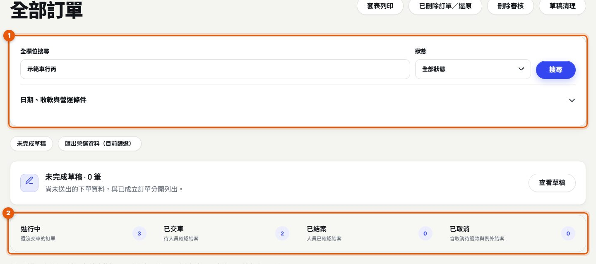
   _① 搜尋與狀態　② 頁籤：進行中／已交車／已結案／已取消_

2. 用頁籤或「狀態」縮小範圍：頁籤分進行中、已交車、已結案、已取消；「狀態」一選就套用。點頁籤會清掉狀態篩選。
   - 範例：進行中 3、已交車 2。

3. 要排序就點表頭，例如「領牌日期」；再點一次切換方向。上方會列出目前的排序，可以「移除」或「全部清除」。
   - 範例：點「領牌日期」後顯示「1. 領牌日期：舊→新」。

   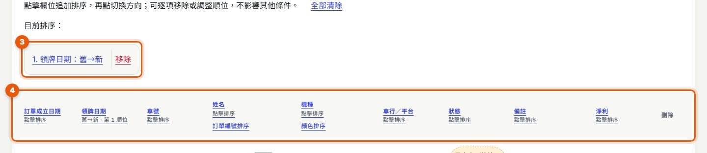
   _③ 目前的排序　④ 點表頭排序_

4. 點訂單進到訂單頁；在訂單頁按 O 可以打開「訂單總覽」，每一欄都能複製。

### 常見問題

**搜得到哪些欄位？**

訂單本身的文字、日期、金額，車的來源、廠牌、車型、車色、引擎／車身號碼，以及配件、費用、文件、收款與處理紀錄。

**每頁顯示幾筆？**

預設 50 筆，可改 25、75、100。

**淨利欄寫「未授權」？**

沒有「查看淨利」權限時不顯示，也不能依淨利排序；請洽 admin。

**要看同一位客人買過哪些車？**

資料維護區「客戶查詢」：用姓名、電話或證件號碼搜尋，點客人看他所有訂單（依訂單日期由新到舊）。

## 9. 讓客人簽訂購單

**什麼時候用**：本店的訂單建立後，要讓客人簽「車輛訂購單」與「個資同意書」時。

_約 3 分鐘・5 個步驟_

### 範例

示範客戶32（合成資料）在店裡，用平板直接簽。

### 怎麼做

1. 訂單成立後畫面會問「這次要怎麼簽？」；之後也可以到訂單左側「列印與簽署文件」。選「在行動裝置上簽名」，或「選擇要印的聯別」印紙本。

   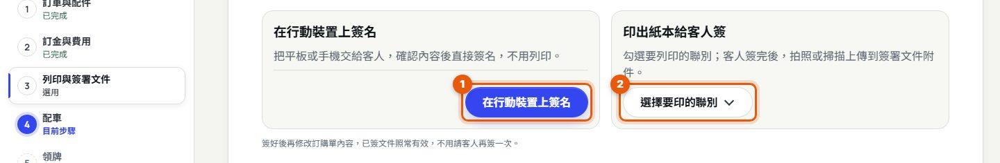
   _① 在行動裝置上簽名　② 印紙本_

2. 行動裝置：請客人看過內容，每份要簽的文件勾「簽署這份文件」。

   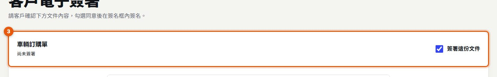
   _③ 簽署這份文件_

3. 確認「簽署人姓名」，勾同意以電子方式簽署，請客人在簽名框簽名（簽歪按「清除重簽」），按「確認簽署」。

   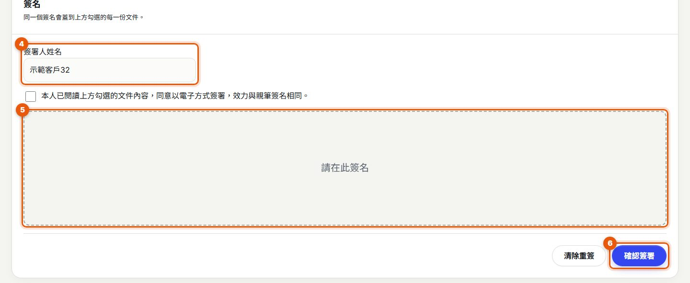
   _④ 簽署人姓名　⑤ 簽名框　⑥ 確認簽署_

4. 出現「簽署完成」：按「完成，返回訂單」；客人要紙本就勾聯別後按「列印勾選的文件」，印出含簽名的版本。

5. 紙本：勾「訂購單・店家留存聯」「訂購單・客戶留存聯」「個資同意書」後列印；客人簽完，在「簽署文件留存」選檔，選好就自動上傳。

> 完成：簽好的文件留在訂單「列印與簽署文件」，之後改訂單內容也不用請客人重簽。

### 常見問題

**車行或網路平台的單要簽嗎？**

不用。這兩種單只能列印，步驟摘要寫「不需客人簽名・可列印個資同意書」。

**沒簽會擋配車或交車嗎？**

不會，簽署步驟標「選用」。

**欣鈴退稅同意書？**

只有 SUZUKI 油車又有汰舊的單會出現，可以電子簽也可以紙本；電子簽的版本帳號欄留白。

**簽名被擋？**

會提示原因，例如「請先在此簽名」「簽名太短或空白」，或內容剛被修改要重新確認。

## 10. 建立後修改訂單

**什麼時候用**：訂單成立後，要改車主、車款、配件、選號交車或付款方式時。

_約 1 分鐘・4 個步驟_

### 範例

示範客戶32（合成資料）改成要指定號碼 6688、8866，選號費 1,200。

### 怎麼做

1. 打開訂單，點左側「訂車與配件」，直接改欄位，不用按儲存。
   - 範例：選號方式改「指定號碼」、選號費 1,200、號碼 6688、8866。

   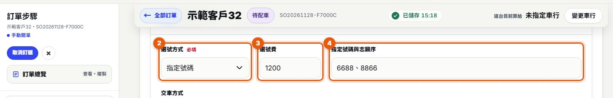
   _② 選號方式　③ 選號費　④ 指定號碼_

2. 停止打字約 1 秒、改選項或離開欄位就會自動儲存。看頁首小標：「儲存中…」變成「已儲存 時:分」就存好了。

   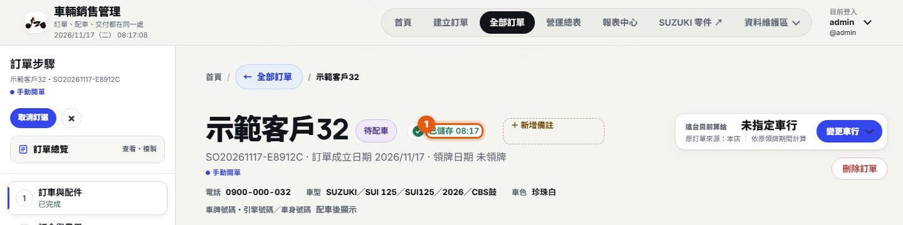
   _① 已儲存_

3. 頁首黃色便條可以直接點進去改備註，和「選號與交車」的備註是同一欄；按 Esc 回到最後存好的內容。

4. 已交車的訂單要改，先勾「我確認這是完成後修正…」才存得進去；交付狀態不會改變。

> 完成：每次修改都記在「處理紀錄」；改了內容不用請客人重簽。

### 常見問題

**上方出現紅條「有修改沒存到」？**

通常是必填欄位沒填。按「前往修正」補好，或按「重試」「放棄修改」。

**兩個人同時改同一張？**

後存的人會被擋下，畫面寫「此訂單已更新…本次未覆寫，您的輸入仍保留」，不會蓋掉對方。按「放棄修改」重新載入後再輸入。

**已配車還能改車型車色嗎？**

可以，但會先確認；確定後會一併取消配車。

**哪些訂單不能改？**

已取消、取消待退款、例外結案的訂單內容都鎖住。

## 11. 配車

**什麼時候用**：訂單建立後，要指定一台實體車給這張單時。

_約 1 分鐘・3 個步驟_

### 範例

王小明的訂單（SUI 125 消光黑）狀態是「待配車」。

### 怎麼做

1. 到「全部訂單」，點王小明那一張，訂單頁會直接停在目前要做的步驟「配車」。
   - 範例：左側步驟 4「配車」標示「目前步驟」。

   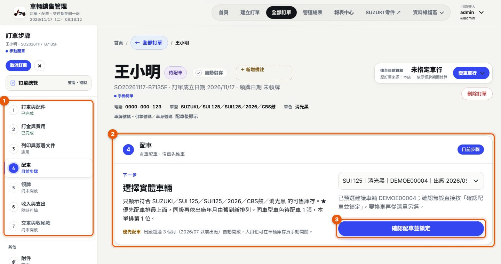
   _① 訂單步驟　② 配車　③ 確認配車並鎖定_

2. 確認右側預選的車：系統只列同車型、同車色的可售庫存，★ 優先配車排最上面，再依出廠年月由舊到新。
   - 範例：預選一台 DEMOE 開頭的消光黑。

3. 按「確認配車並鎖定」。要換車就先從清單另選一台再按。
   - 範例：訂單狀態變成「已配車」，左側步驟 5「領牌」開放。

> 完成：這台車保留給這張訂單，不會再被配給別人。 下一步：領牌。

### 常見問題

**清單裡沒有車？**

代表沒有同車型、同車色的可售庫存。先到「資料維護區 › 車輛庫存」進車，或請行政調車。

**配錯了怎麼辦？**

在同一區改選另一台車再確認；原本那台會回到可售庫存。

### 規則細節

- 出廠超過 3 個月的車自動列為優先配車，人員也可在車輛庫存頁手動開關。

## 12. 領牌

**什麼時候用**：車已配好、實際去監理站領完牌照時。

_約 3 分鐘・3 個步驟_

### 範例

王小明的車在 2026/11/16 領牌，車牌 ABC-1234。

### 怎麼做

1. 在訂單左側點「領牌」，填領牌日期與車牌號碼。可以先填預計日，實際領牌後再確認。
   - 範例：2026/11/16、ABC-1234。

   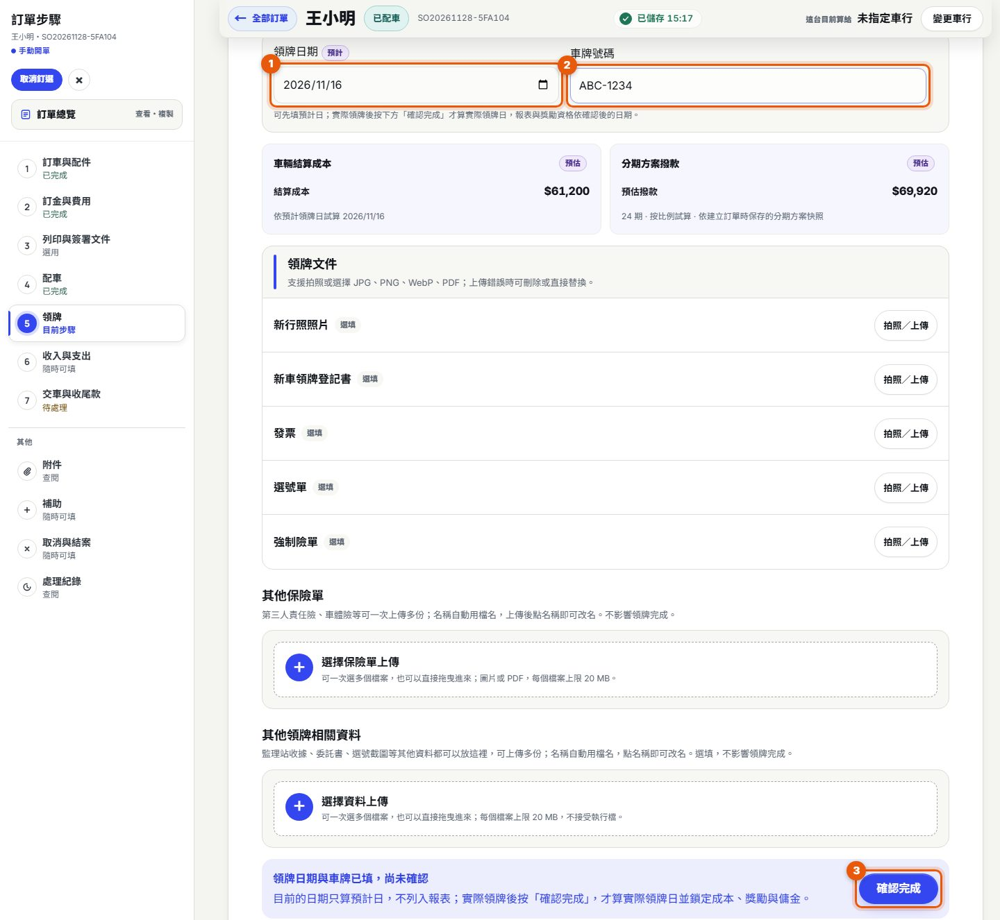
   _① 領牌日期　② 車牌號碼　③ 確認完成_

2. 新行照、登記書、發票等領牌文件可以順手上傳（選填，不擋後續步驟）。

3. 按「確認完成」，核對視窗裡的日期、車牌與規費，再按「確認完成並鎖定」。
   - 範例：視窗顯示牌險規費 706＋658＝1,364 元；分期單由本店吸收，照列支出、不向客人收。

   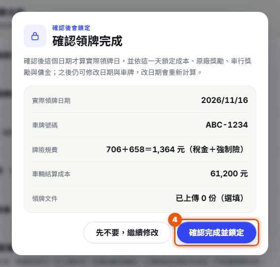
   _④ 確認完成並鎖定_

> 完成：實際領牌日鎖定，訂單進入「待交車」；成本、原廠獎勵與傭金依這一天計算。 下一步：交車並收尾款。

### 常見問題

**確認後發現日期打錯？**

領牌日期與車牌仍可修改；改日期會依新日期重算系統帶入的金額。

**一定要上傳文件才能確認嗎？**

不用。文件都是選填，不會擋領牌完成或交車。

### 規則細節

- 報表與獎勵資格都依「確認完成」後的實際領牌日；只填預計日不算已領牌。

## 13. 交車並收尾款

**什麼時候用**：客人來牽車、要收清尾款並完成交車時。

_約 3 分鐘・4 個步驟_

### 範例

客人**王小明**（合成資料）要買 SUI 125 消光黑，分期 24 期、想選號 8899、加裝後箱，今天先付現金訂金 3,000。

- 車價（分期總價）：76,000，系統帶入
- 分期：示範融資 24 期 × 3,500，開辦費 1,500
- 牌險費：留空＝不向客人收（分期單本店吸收）
- 選號：指定號碼 8899、9988，選號費 1,200
- 加購：示範後箱 1,500＋工資 200
- 訂金：現金 3,000

系統會算出：

- **分期外應收 4,400**＝牌險 0＋選號 1,200＋配件 1,700＋開辦費 1,500
- **交車時尾款 1,400**＝4,400－訂金 3,000

### 怎麼做

1. 在訂單左側點「交車與收尾款」，先看「應收怎麼算」。
   - 範例：總價 80,400－分期公司撥款 76,000－已收訂金 3,000＝**應收 1,400**。

   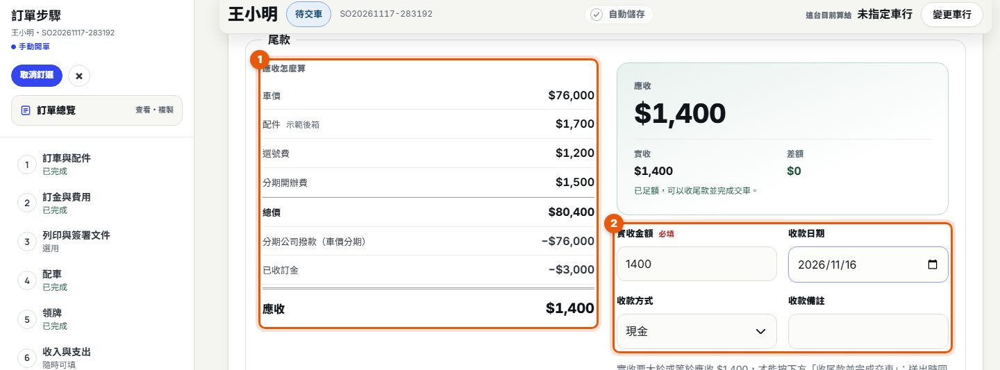
   _① 應收怎麼算　② 實收、收款日期與方式_

2. 填實收金額、收款日期與收款方式。實收要大於或等於應收，才能完成交車。
   - 範例：實收 1,400、現金。

3. 拿「交車前確認」的配件清單對照實車。
   - 範例：示範後箱 ×1。

4. 確認交付方式、實際交付時間與收車人，按「收尾款並完成交車」。
   - 範例：客人來店取車、收車人王小明。

   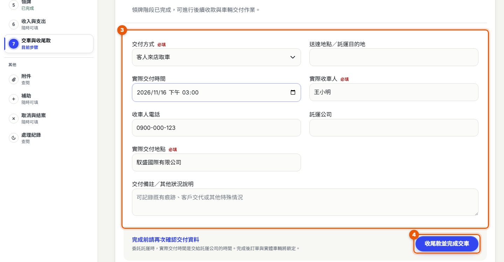
   _③ 交付資料　④ 收尾款並完成交車_

> 完成：訂單變成「已交車／待結案」，尾款同時入帳。 下一步：套表列印。

### 常見問題

**尾款可以先收嗎？**

尾款只在交車時登記；交車前的其他款項可在「收入與支出」按「＋ 新增收款」。

**分期公司還沒撥款能交車嗎？**

可以。分期與平台撥款都是事後對帳，不擋交車，也不算進客人的應收。

### 規則細節

- 交車完成後，訂單與實體車輛鎖定；委託託運時，實際交付時間是交給託運公司的時間。

## 14. 收訂金與登記收款

**什麼時候用**：客人付訂金，或後來又分批匯款、刷卡時。

_約 2 分鐘・4 個步驟_

### 範例

示範客戶32（合成資料）建單時付現金訂金 3,000；三天後又匯款 1,000。

- 訂金：現金 3,000（建單時）
- 分批匯款：1,000，客戶收款，匯款

### 怎麼做

1. 建立訂單第 6 步「訂金與費用」填訂金、日期、付款方式；填了就視為已收到，建立時直接入帳。

   
   _② 訂金_

2. 之後收到的錢：訂單左側「收入與支出」→「收款」，按「＋ 新增收款」，填收款項目、收款對象、實收金額、收款日期、收款方式。
   - 範例：分批匯款、客戶收款、1,000、2026/11/15、匯款。

   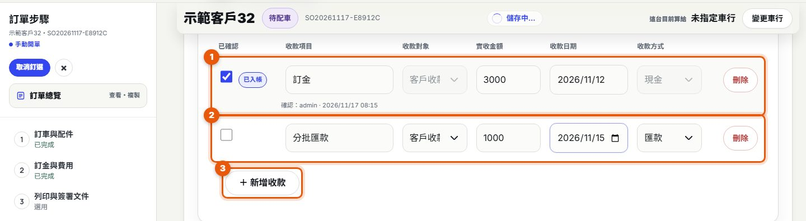
   _① 建單時的訂金（已入帳）　② 新增的收款　③ ＋ 新增收款_

3. 確定錢已經進來，勾該列的「已確認」，在確認視窗按「確認入帳並鎖定」。

   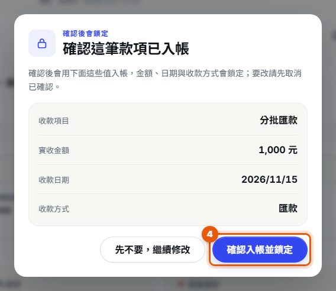
   _④ 確認入帳並鎖定_

4. 勾錯了就取消「已確認」再修改；登記錯按該列「刪除」。

> 完成：確認後才算實收，金額、日期與方式鎖定；尾款在交車時一起登記。 下一步：交車並收尾款。

### 常見問題

**尾款可以先在這裡收嗎？**

不行，尾款只在交車時登記（〈交車並收尾款〉）。

**同一天收兩筆一樣的金額？**

要勾「確認非重複收款」才存得進去。

**刷卡要收手續費？**

收款方式選「刷卡」才會出現「向客戶收取手續費」；其他方式不能填。

**分期公司撥款在哪登記？**

到「統一撥款對帳」入帳，不在這裡。

**訂金欄說比總價還多？**

通常是多打了一個 0；分期單只超過分期外應收時只提醒、不擋。

### 規則細節

- 收款對象分客戶收款／分期公司撥款；車行單顯示「車行收款」。
- 金額不能是負數；已取消或例外結案的單只能看不能改。
- 舊的「已沖銷」收款不能取消確認，也不能刪。

相關：整理一張訂單的收支、交車並收尾款

## 15. 看營運總表

**什麼時候用**：想知道這個月好不好、比上月和去年同期多少、哪裡卡住要處理時。

_約 3 分鐘・5 個步驟_

### 範例

11/17 打開「本月」：比較的是 11/1–17、上月同期 10/1–17、去年同期 11/1–17。

### 怎麼做

1. 頁首「營運總表」，上方切換「本月」／「上月」／「今年至今」。最上面一句話說明台數比上月同期多少、成交額，以及有幾件需要處理。

   
   _① 期間　② 一句話摘要_

2. 看「現在好不好」卡片：領牌台數、車款成交額、訂單淨利、新成立訂單，各附上月同期、去年同期與近 12 個月走勢。

   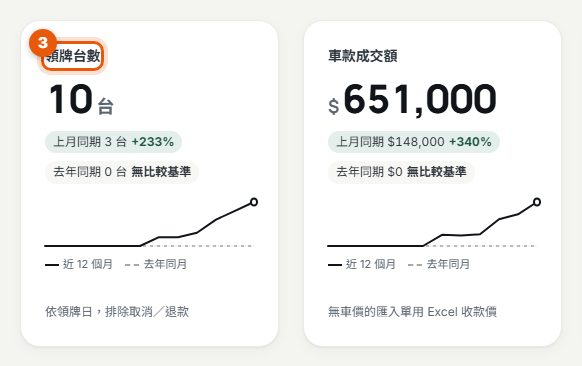
   _③ 每張卡片附兩個比較_

3. 看「需要處理」：只列有事的項目，紅色優先；點一下就進到對應清單。

   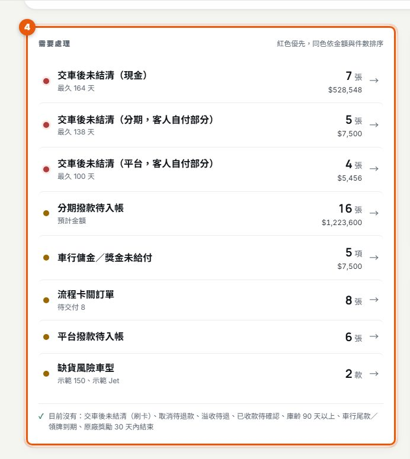
   _④ 需要處理_

4. 往下依序是訂單流程、錢、貨、結構變化、車型貢獻、台數獎金進度、原廠獎勵與資料可信度；左側目錄可以直接跳到該段。

5. 資料最多快取 10 分鐘，要立刻重算按「重新整理」。

### 常見問題

**成交怎麼算？**

依按過「確認完成」的實際領牌日，排除取消、待退款、例外結案；預計領牌日不算。新成立訂單依成立日。

**淨利卡寫要權限？**

要有「查看淨利」權限；有權限時只加總有成本的單，卡片寫「X／Y 筆可計入」。

**為什麼沒有上月同期？**

「今年至今」不和上月比；比較基準是 0 時顯示「無比較基準」。

**卡關天數怎麼判斷？**

待配車 3 天、待領牌 30 天、待交付 7 天、交車待文件 14 天以上就標出來。

# 偶爾用

車行結算、補助、取消、對帳與庫存

## 16. 車行傭金與台數獎金

**什麼時候用**：月底要結算台數獎金、看每家車行這個月該拿多少傭金和台數獎金、哪些已經付了時。

_約 5 分鐘・5 個步驟_

### 範例

**示範車行丙**（合成資料）10 月賣了 3 台 SUI 125：10/12 分期、10/19 現金、10/28 分期，都已確認領牌。SUI 125 的車行基礎傭金每台 1,500；另有一條台數獎金規則「10 月滿 3 台，每台加 500」。

- 基礎傭金：每台 1,500（機種設定）
- 台數獎金規則：10 月滿 3 台，每台 500
- 10 月實績：3 台，達門檻

系統會算出：

- **傭金 4,500**＝3 台 × 1,500；畫面每台一列，標「抵扣應收」
- **台數獎金 1,500**＝達 3 台門檻，3 台 × 500；10 月結束後按「結算」才算數
- **未給付合計 $6,000**＝結算前 4,500，結算後 4,500＋1,500

### 怎麼做

1. 頁首「報表中心」，左側「給付追蹤」點「車行傭金／獎金給付」。「車行」選示範車行丙，按「套用」。
   - 範例：最上方黑底區顯示未給付金額 $4,500，下方提示「台數獎金待結算 1 組 · $1,500」。

   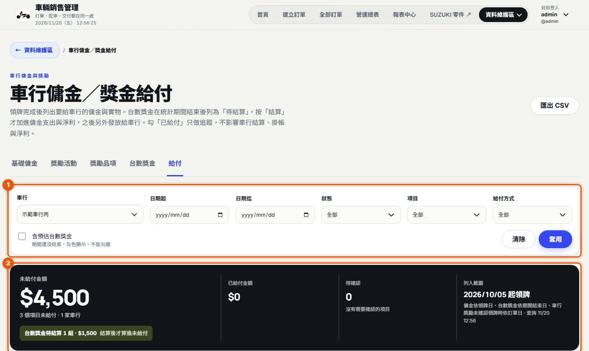
   _① 篩選：車行、日期、狀態、項目、給付方式　② 未給付／待結算／已給付／待確認_

2. 看車行卡片：每張已確認領牌的訂單一列傭金，台數獎金另成一區；期間結束、還沒結算的台數獎金標「待結算」。
   - 範例：3 列傭金各 $1,500（標「抵扣應收」），「示範十月台數獎金」$1,500 標「待結算」，還不能勾已給付。

   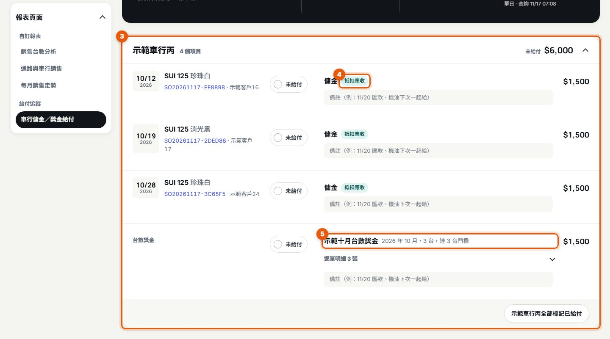
   _③ 一家車行一張卡片　④ 給付方式　⑤ 待結算的台數獎金_

3. 月底核對沒問題，按台數獎金旁的「結算」，確認卡會列出台數、門檻、每台金額、合計與逐單明細；按「確認結算」。
   - 範例：3 台、達 3 台門檻、每台 $500，結算金額 $1,500；確認後 3 張訂單的傭金支出各加 500，淨利跟著反映。

   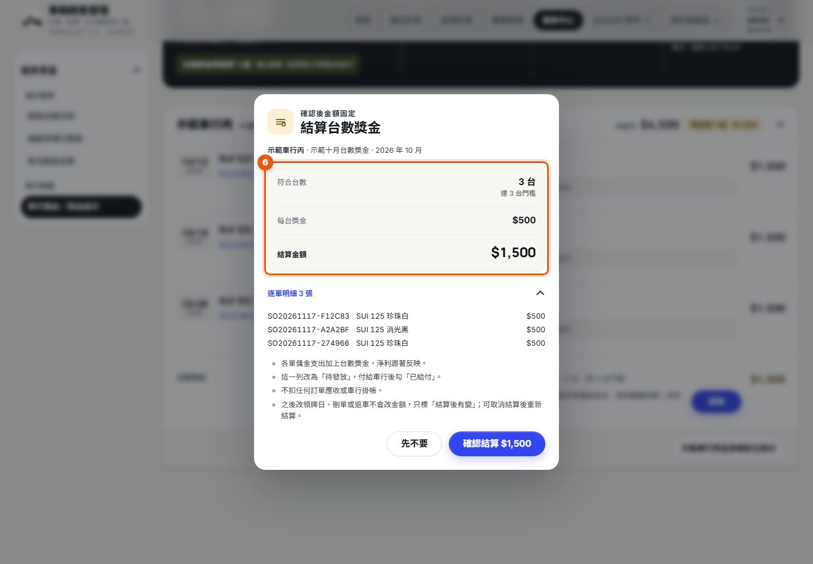
   _⑥ 台數、每台金額與結算金額_

4. 結算後這一列改為「待發放」，算進未給付；匯款後點「待發放」改成「已給付」；整家都付完可以按「全部標記已給付」。實際匯款日寫在「備註」。
   - 範例：台數獎金匯款後點一下，變成「已給付」，下方記下結算與登記的時間、人員；已給付金額變成 $1,500。

   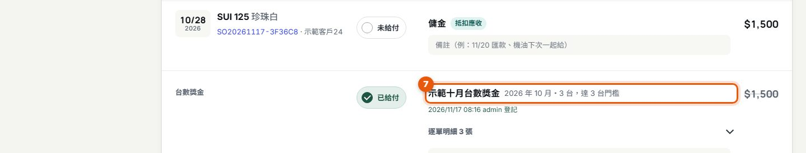
   _⑦ 已給付，記下時間與登記人_

5. 需要留存或給會計：按右上「匯出 CSV」。

> 完成：「結算」才會把台數獎金加進傭金支出與淨利；勾「已給付」只是追蹤，不會寫入收支、不影響車行結算或淨利，點錯可以再點一次取消，歷程會保留。台數獎金一律另外發放，不扣訂單應收或車行掛帳。

### 常見問題

**「抵扣應收」和「另付」差在哪？**

「抵扣應收」是這筆傭金直接從車行要付給本店的錢裡扣掉，不用另外匯；「另付」是要另外匯給車行。台數獎金一律另外發放給車行，不扣訂單應收或車行掛帳。

**這個月的台數獎金怎麼還沒出現？**

統計期間結束的隔天起，台數獎金會列為「待結算」。期間還沒結束時，勾「含預估台數獎金」可以先看灰色的預估，不能結算、不能勾選，也不算進合計。

**結算後發現台數不對？**

結算後金額固定，之後改領牌日、刪單或退車不會自動改，只會標「結算後有變」。要改就按「取消結算」再重新結算；如果已經勾了「已給付」，要先取消已給付。

**傭金是怎麼來的？**

車行單的傭金＝機種的車行基礎傭金＋該車行的品牌加減；確認領牌時就固定下來。台數獎金結算後，訂單的傭金支出會加上獎金，但給付頁的傭金列和訂單的「車行結算」仍只算基礎傭金，獎金另成一區，不會重複。

**哪些訂單會列出來？**

已按「確認完成」領牌、而且領牌日在 2026/10/05 以後的車行單。只填預計領牌日的不算。

**看不到這一頁？**

要有「車行傭金／獎金給付」權限（查看、操作、匯出分開授權），請洽 admin。

### 規則細節

- 傭金依領牌日、台數獎金依統計期間結束日歸入日期範圍。
- 台數獎金取達到的最高門檻，同一群組每張訂單都拿那個門檻的每台金額；不同規則的獎金會累加，每家車行各自計算。
- 台數獎金以「規則 × 期間 × 車行」為一組結算；結算前只是試算，不計入傭金支出與淨利。
- 分期單的傭金可抵扣金額＝車行要付的費用－訂金，超過的部分改列「另付」。
- 車行獎勵活動的實物只列數量，不列金額，不算進合計。

相關：報表中心：查一段期間的車行排行、整理一張訂單的收支

## 17. 套表列印

**什麼時候用**：要一次印好幾張訂單的信封、聲明書、簽收單或身分證影本時。

_約 3 分鐘・4 個步驟_

### 範例

王小明交車後，要印信封、簽收單和身分證影本。

- 信封：油車版，下載 Word 檔
- 簽收單：A4 PDF
- 身分證影本：A4 PDF，每頁 5 組

### 怎麼做

1. 到「全部訂單」，按頁首的「套表列印」，用搜尋或「範圍」（進行中／已交車／全部）找到訂單。
   - 範例：搜尋「王小明」、範圍「全部」。

2. 勾選每張訂單要印的套表。點該列最左邊的方塊，會一次勾好建議的套表；身分證影本要另外勾。
   - 範例：勾好信封・油車、簽收單，再勾身分證影本，左側列印清單顯示 3 份。

   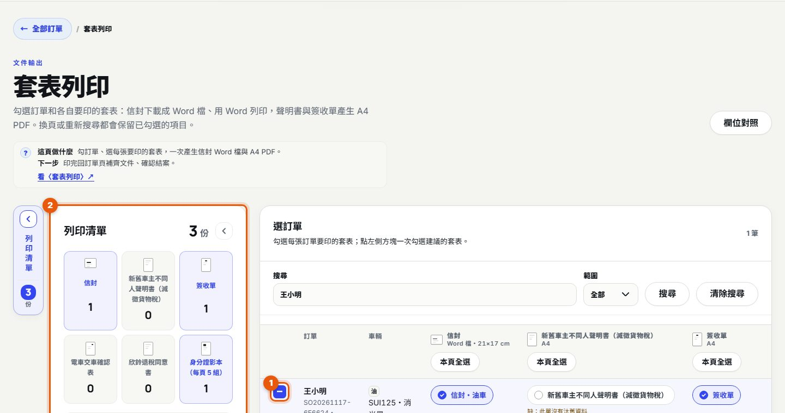
   _① 一次勾建議的套表　② 列印清單_

3. 身分證影本會在左側列印清單多一格「影本備註」，預設帶車行或平台名稱和車主電話（本店單只有電話），可以改，不會存進訂單。按「預覽」（或按 P）逐頁檢查；要調裁切，在預覽裡點證件。
   - 範例：共 3 頁：簽收單、身分證影本、信封。勾 6 張訂單的身分證影本時，影本會排成 2 頁（5 組＋1 組）。

   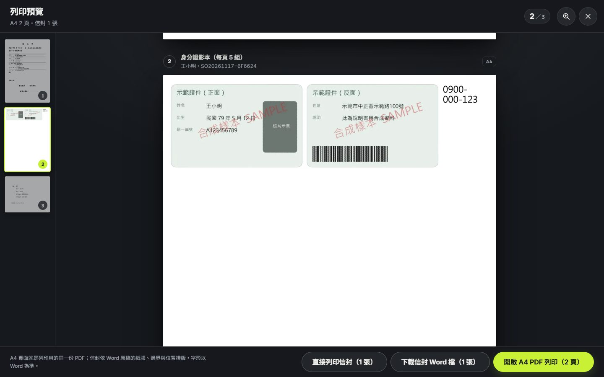
   _身分證影本每頁 5 組，正反面並排、右側是備註_

4. 信封按「下載信封 Word 檔」，用 Word 列印；其他套表按「開啟 A4 PDF 列印」，在新分頁列印。
   - 身分證影本列印時，縮放一定要選「實際大小」，卡片才會是 82.7 × 52.2 mm。只印一張訂單的影本，也可以在訂單的「列印與簽署文件」按「列印身分證影本」。

   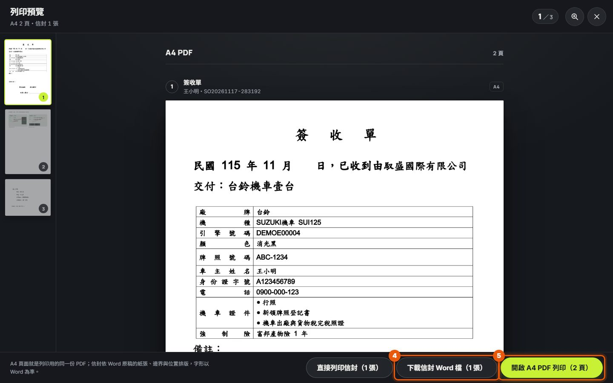
   _④ 下載信封 Word 檔　⑤ 開啟 A4 PDF 列印_

> 完成：印完就好，訂單資料不會被改動。電車信封（含車控密碼）、退稅同意書、身分證影本與在預覽中調整裁切，會記在訂單處理紀錄。 下一步：補齊文件、結案。

### 常見問題

**信封印偏或被縮小？**

改用「下載信封 Word 檔」最穩。要直接用瀏覽器印，印表機得先設好「21×17 公分」自訂紙張，縮放選「實際大小」、邊界選「無」，第一次先試印一張。

**某一格寫「不適用」？**

這張訂單用不到那份套表：電車交車確認表只給 eReady、eMOVING 電車；退稅同意書只給 SUZUKI 油車有汰舊；身分證影本不能用在法人或沒有證件照片的訂單。

**表格寫「缺：…」能印嗎？**

可以，這只是提醒，空白處現場手寫。

**手機上找不到列印清單？**

點左側窄條，清單會從左邊滑出；點外面或按 Esc 收回。

### 規則細節

- 建議勾選：信封、簽收單一定勾；有汰舊加聲明書；eReady、eMOVING 電車加電車交車確認表；SUZUKI 油車有汰舊加退稅同意書。身分證影本不會自動勾。
- 預覽不改資料；但預覽退稅同意書（含補助撥款帳戶）與調整證件裁切會記入處理紀錄。
- 排列方式「依套表分組」把同一種套表排在一起；「依訂單」把同一張訂單的文件排在一起。

## 18. 汰舊與補助

**什麼時候用**：客人要申請政府補助或汰舊換新時。

_約 5 分鐘（文件另計）・5 個步驟_

### 範例

示範客戶32（合成資料）要申請新購補助；資料在訂單頁「補助」補齊。

### 怎麼做

1. 建立訂單第 3 步 **汰舊與補助**：勾「申請補助（可多選）」，只會列出符合車種的方案；同一組只能擇一。方案外的補助勾「其他」再填名稱。

   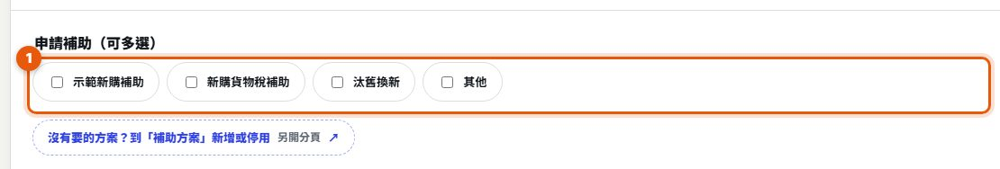
   _① 申請補助（可多選）_

2. 勾到汰舊類方案才會出現「新舊車主不同人」；同一人不用勾。

3. 建單後到訂單左側「補助」，用「＋ 新增補助項目」填補助名稱、補助金額、申請日期與狀態；下方填舊車主資料與舊車車牌。

   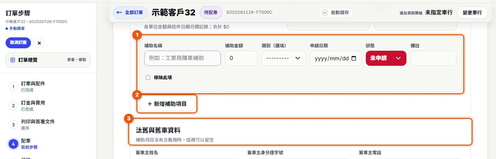
   _① 新增的補助項目　② ＋ 新增補助項目　③ 汰舊與舊車資料_

4. 「舊車出廠年月」直接打 6 碼，例如 201309，下方會換算成「2013 年 9 月・民國 102 年」。

5. 補助文件逐列按「拍照／上傳」，都是選填；撥款帳戶在補助項目標題列右側（要有財務權限才能改）。

> 完成：區塊右上顯示「✓ 資料齊全」就代表資料備妥；文件不影響是否完成。

### 常見問題

**文件一定要傳嗎？**

不用，都是選填，只計份數；不會擋交車或補助完成。

**怎樣算補助資料齊全？**

有汰舊時要有舊車車牌與補助項目；新舊車主不同人時，再加舊車主姓名與證號。

**取消勾選方案會刪掉什麼？**

只刪「未申請」而且沒填申請日期的項目。

### 規則細節

- 同一單位的新購與汰舊只能擇一，否則顯示「「A」與「B」只能擇一。」

## 19. 一台車用多種付款

**什麼時候用**：客人一台車同時用現金、刷卡、匯款或分期付款時。

_約 2 分鐘・4 個步驟_

### 範例

SUI 125（合成資料）現金價 72,000、分期總價 76,000。客人先付現金 20,000，其餘分期。

- 第 1 筆：現金 20,000
- 第 2 筆：分期 56,000（示範融資 24 期）

系統會算出：

- **車價合計 76,000**＝現金 20,000＋分期 56,000
- **客人自付 21,500**＝自付車款 20,000＋開辦費 1,500（分期單牌險留空不收；訂金從這裡扣）

### 怎麼做

1. 建單第 1 步「付款與車價」預設一筆現金。把它改成 20000，再按「＋ 新增付款方式」。
   - 範例：新的一筆依序帶入還沒用過的方式（現金→刷卡→匯款→分期），先出現「刷卡」。

2. 把第 2 筆改成「分期」。空白的金額欄會提示還差多少才等於售價（有分期就用分期總價比對）。
   - 範例：提示「尚餘 $56,000」。

   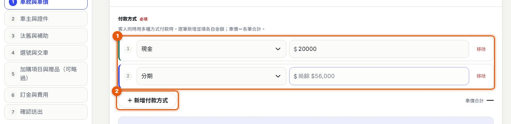
   _① 兩筆付款　② ＋ 新增付款方式_

3. 照提示填 56000，下方選分期公司與期數。右下「車價合計」即時加總。
   - 範例：車價合計 $76,000。

   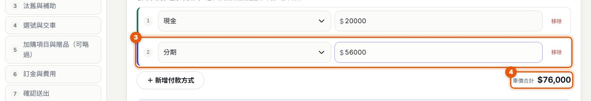
   _③ 分期 56,000　④ 車價合計_

4. 不要的那筆按「移除」；只剩一筆時沒有移除按鈕。

> 完成：分期公司撥款只依分期那一筆計算；其他各筆由客人自付，算進客人的分期外應收與尾款。

### 常見問題

**沒有分期也能拆嗎？**

可以，例如現金 50,000＋刷卡 22,000，合計等於現金價。

**沒有調價權限？**

只有一筆時金額是唯讀，要先新增一筆；各筆合計必須等於售價。

**「尚餘」什麼時候會出現？**

有兩筆以上、而且售價已帶入時，出現在空白的金額欄；打字後就不見。

### 規則細節

- 計價基準：有分期用分期總價；全部刷卡用刷卡價；其他用現金價。
- 尾款＝分期外應收－訂金；分期外應收＝自付車款＋選號費＋配件＋開辦費＋其他費用－已核准優惠。

相關：建立訂單

## 20. 接續或刪除草稿

**什麼時候用**：建單做到一半中斷，要接著填或丟掉時。

_約 1 分鐘・4 個步驟_

### 範例

填到一半客人要走，草稿留在系統裡；隔天從全部訂單接著填。

### 怎麼做

1. 建單時每按一次「下一步」，系統就會存草稿；停 5 秒也會自動存，畫面顯示「草稿已儲存 時間」。

2. 要接著填：「全部訂單」上方「未完成草稿」按「查看草稿」。

   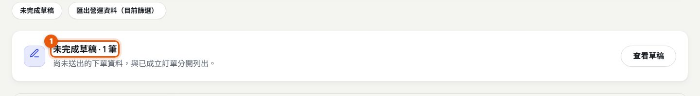
   _① 未完成草稿_

3. 在要的那一筆按「接續填單」，會回到還沒完成的那一步。

   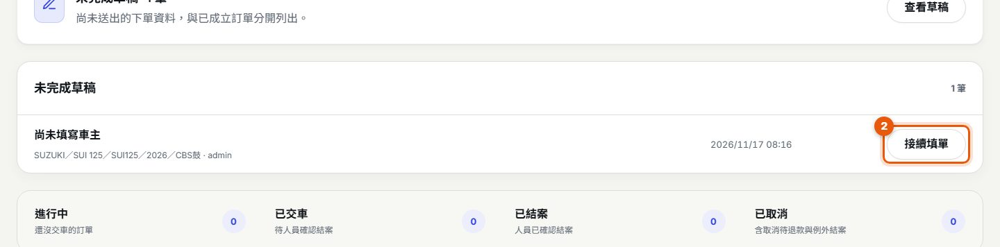
   _② 接續填單_

4. 不要的草稿在填單畫面按「刪除草稿」並確認；草稿和暫存的證件照片會一起刪除，無法復原。

### 常見問題

**「我的接待草稿」在哪？**

要從首頁「編輯常用功能」加入；它只列你自己的接待草稿，按「繼續本筆下單」。

**畫面說別人正在編輯？**

同一份草稿同時只能一個人改。對方關掉頁面就會釋放；異常關閉時約 90 秒後解除。

**沒看到「刪除草稿」？**

要等草稿第一次存好才會出現。

**admin 要清掉別人的草稿？**

全部訂單的「草稿清理」可以永久刪除（不顯示客戶資料，會留稽核紀錄）。

## 21. 整理一張訂單的收支

**什麼時候用**：要核對一張單賺多少，或修正系統帶入的收支金額時。

_約 5 分鐘・4 個步驟_

### 範例

王小明（合成資料）的分期單交車後，核對這張單的收入與支出（本店單、沒有承辦人員傭金）。

- 撥款比例：示範融資 24 期，92%
- 車輛成本：61,200（合成資料）
- 牌險：分期單本店吸收，收入 0、規費 706＋強制險 658 照列支出

系統會算出：

- **收入小計 72,765**＝預估車價收入 69,920（76,000 × 92%）＋選號收入 1,200＋分期手續費收入 1,500＋強制險傭金 145
- **支出小計 65,064**＝車輛成本 61,200＋領牌稅金 706＋強制險 658＋選號支出 1,000＋分期手續費支出 1,500
- **淨利 7,701**＝72,765－65,064

### 怎麼做

1. 打開訂單，點左側「收入與支出」，先看收入與支出兩欄的小計；上方「收支總覽」有收入合計、支出合計與淨利。
   - 範例：收入小計 $72,765、支出小計 $65,064。

   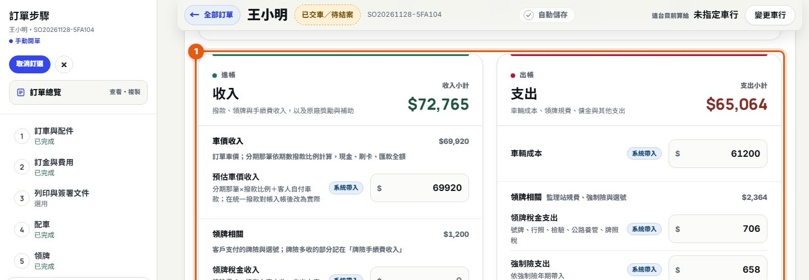
   _① 收入小計與支出小計_

2. 往下逐列核對收入與支出。每列標「系統帶入」「已人工調整」或「自動同步」；改過的列變成「已人工調整」，之後不會被系統覆蓋。
   - 範例：領牌稅金收入、強制險收入是 0（分期單本店吸收），傭金支出 0（本店單、沒有承辦人員）。

   
   _② 領牌稅金收入 0　③ 傭金支出_

3. 傭金支出建單時就帶入、確認領牌時固定：車行單＝基礎傭金＋車行加減（台數獎金在給付頁結算後再加上；還沒結算時，淨利下方會提示試算金額，不計入淨利）；本店單帶入承辦人員的傭金。

4. 要給折扣：在「內部折扣」選調整方式，填減少金額或折數，按「套用折扣」。需要財務編輯與折扣核定權限。

> 完成：淨利＝收入合計－支出合計；車價收入在統一撥款對帳入帳後，從「預估」改成「實際」並鎖定。

### 常見問題

**分期單的牌險為什麼沒有收入？**

分期單牌險由本店吸收：牌險費留空就不向客人收，收入 0、規費與強制險照列支出。

**折扣會影響分期撥款或傭金嗎？**

不會；畫面寫明「分期公司撥款、佣金與成本不變」，折扣只扣客人應收。

**誰看得到淨利？**

只看「查看淨利」權限，不用輸密碼；沒權限顯示「未授權」。整個收入與支出步驟另外要訂單財務權限。

**顯示「待核對，未列入淨利合計」？**

車輛成本還是 0 或匯入核對沒過，先補成本。

### 規則細節

- 車輛成本建單時先帶預估，確認領牌後依領牌日固定。
- 加購配件不算進收支：配件的售價與工資只算在客人應收，不列收入、也不列成本，所以不影響淨利。
- 折扣只減客人應收；收入與支出每一列都不變，淨利也不變。

相關：收訂金與登記收款、車行傭金與台數獎金

## 22. 取消、退款與沒收

**什麼時候用**：客人不買了（還沒領牌、還沒交車），要取消訂單並處理已收的錢時。

_約 3 分鐘・4 個步驟_

### 範例

示範客戶31（合成資料）已付現金訂金 3,000，決定不買；約定沒收 1,000、退 2,000。

系統會算出：

- **應退 2,000**＝已確認實收 3,000－沒收 1,000

### 怎麼做

1. 訂單左側「取消與結案」→「訂單取消與退款」，按「展開取消流程」（展開不會取消），需要時填備註，按「登記取消訂單」並確認。

   
   _① 登記取消訂單_

2. 沒有已確認的收款：直接變成已取消。有已確認收款：訂單變成「取消待退款」，配好的車立即釋回。
   - 範例：已收 3,000，變成取消待退款。

3. 在「取消待退款結算」填 **沒收金額**（不沒收填 0）、退款完成日期、退款方式，需要時填帳號與上傳退款證明，按「確認結算並完成取消」。
   - 範例：沒收 1,000、現金退 2,000。

   
   _② 沒收金額　③ 確認結算並完成取消_

4. 完成後訂單狀態改為「已取消／已退款」；系統另記一筆負數的「取消退款」。

   
   _訂單頁首顯示目前狀態_

### 常見問題

**系統不讓我取消？**

已交付、已領牌、分期公司已撥款，或還有已登記但沒確認的收款時會擋下；已領牌改走「領牌後棄單（例外結案）」。

**客人又改變心意？**

還在「取消待退款」時可以按「撤銷取消」，訂單回到待配車，要重新配車。

**已領牌但客人不要車？**

用「領牌後棄單（例外結案）」：填沒收金額、領牌車再售價與日期；沒收備註可以留空。

**已交車要退車？**

只有 admin 可以在訂單頁首按「交車後退車」。

### 規則細節

- 應退金額＝已確認淨實收－沒收金額，系統計算。
- 有沒收金額的訂單之後不能刪除。

## 23. 補齊文件、結案

**什麼時候用**：交車後，補助與文件都處理完，要把訂單移到「已結案」時。

_約 1 分鐘（補助另計）・3 個步驟_

### 範例

王小明的訂單已交車，狀態「已交車／待結案」；沒有申請補助，文件都已齊全。

### 怎麼做

1. 打開訂單，確認左側「補助」與「附件」都處理完。
   - 範例：狀態列顯示「已交車／待結案」。

   
   _訂單頁首顯示目前狀態_

2. 在左側點「取消與結案」，找到「確認結案」。系統不會自動結案，補助是否跑完由人判斷。

   
   _① 確認結案_

3. 按「確認結案」，在確認視窗再按一次。
   - 範例：訂單移到全部訂單的「已結案」。

> 完成：訂單列在「已結案」。之後還有補助或文件要處理，可以按「撤回結案」回到「已交車」。

### 常見問題

**結案後發現補助還沒入帳？**

按「撤回結案」回到「已交車」，處理完再結案一次。

## 24. 報表中心：查一段期間的車行排行

**什麼時候用**：想知道某段期間誰賣最多，並且直接看到是哪幾張訂單時。

_約 3 分鐘・6 個步驟_

### 範例

主管想知道 **2026/09/01～11/30** 哪一間車行賣最多？是哪幾張單？（30 張合成訂單）

系統會算出：

- **示範車行丙 4 張**＝占這段期間 23 張的 17.4%；本店 11 張、示範網路平台 5 張不算車行

### 怎麼做

1. 按頁首「報表中心」，左側「報表頁面」選「通路與車行銷售」。填開始日期與結束日期，改完畫面會自動更新，不用按搜尋。
   - 範例：2026/09/01～2026/11/30。

   
   _① 報表頁面　② 期間與篩選_

2. 看「車行／平台台數排行」。
   - 範例：本店 11、示範網路平台 5、**示範車行丙 4**、甲 2、乙 1。

   
   _③ 排行_

3. 點「示範車行丙」，同一頁的其他圖表跟著篩選。
   - 範例：左邊「來源類型占比」變成「車行 4 張」。

   
   _④ 點這一列　⑤ 其他圖表一起變_

4. 要取消，按上方「移除『…』×」，或再點一次同一列。

   
   _⑥ 目前的篩選條件_

5. 按圖表下方「查看來源訂單 →」，右側列出這幾張訂單；點單號回到原訂單。
   - 範例：列出 4 張 SUI 125 的訂單。

   
   _來源訂單：依目前篩選_

6. 要帶走結果：按圖表右上「匯出 CSV」，或頁首「列印／另存 PDF」。

> 完成：篩選條件寫在網址裡：把網址貼給同事，對方打開就是同一個畫面（對方也要有這份報表的權限）。

### 常見問題

**數字跟營運總表或全部訂單對不起來？**

報表依「領牌日期」統計，未確認領牌、草稿與取消的訂單不算；數的是台數，不是金額。

**想同時看兩間？**

按住 Ctrl（Mac 用 ⌘）再點，或勾選「複選分類」。

**看不到報表？**

報表由 admin 建立、發布並開放給你，請洽 admin。

## 25. 分期與平台撥款對帳

**什麼時候用**：分期公司或網路平台把車款匯進來，要登記實際入帳金額時。

_每筆約 30 秒・5 個步驟_

### 範例

王小明（合成資料）的分期單：示範融資 24 期、車價分期 76,000、撥款比例 92%。分期公司匯入 69,920。

- 分期金額：76,000
- 撥款比例：92%（分期方案設定）
- 實際入帳：69,920

系統會算出：

- **預計撥款 69,920**＝76,000 × 92%
- **差額 0**＝實際 69,920－預計 69,920

### 怎麼做

1. 營運總表頁首按「統一撥款對帳」，或點「分期／平台撥款待入帳 N 筆」直接看待入帳的單。

2. 用「對帳對象」（分期公司撥款／平台撥款）、「入帳狀態」與搜尋縮小範圍，按「套用」。
   - 範例：搜尋「王小明」、入帳狀態選「待入帳」。

   
   _① 篩選　② 預計金額　③ 實際金額與入帳_

3. 在那一列填 **實際金額**，按「入帳」；輸入時差額欄會先試算。入帳日期就是按下的那天，系統自動記錄。
   - 範例：填 69,920，按「入帳」，出現「已登記…實際入帳 69,920 元，訂單收支已同步」。

   
   _④ 差額　⑤ 取消入帳_

4. 這張單的撥款本來就和方案不同時，先展開「本單特殊撥款」填「調整後預計金額」，再填實際金額入帳。

5. 平台撥款一次匯多張：勾選那幾張、各填金額，按下方「N 張一起入帳」。登記錯了按那一列的「取消入帳」，改好再入帳。

> 完成：入帳後，訂單收支的「預估車價收入」改成「實際車價收入」並鎖定。

### 常見問題

**差額是什麼？**

實際入帳－預計撥款，只給你判斷，不會自動記成手續費。平台撥款沒有預計值，差額顯示「—」。

**哪些單會出現在這裡？**

系統建立的分期單和網路平台單。現金、刷卡、匯款和 Excel 匯入的舊單不在這裡。

**出現「同日同額」的提醒？**

同一天有一筆一樣金額的入帳，怕重複登記；確定是另一筆收款，勾「確認非重複收款」再入帳。

**實際金額填 0 會怎樣？**

只會存下特殊預計金額，不算入帳。

**撥款會擋交車嗎？**

不會；撥款是交車後的對帳，不算在客人交車應收裡。

### 規則細節

- 已取消或已沖銷的列不能改，也不能取消入帳。
- 實際車價收入＝撥款實收＋客人自付的車款。

相關：整理一張訂單的收支、看營運總表

## 26. 進車、調車與現有台數

**什麼時候用**：原廠或車行的車進來要登錄、車要調給別的車行，或要點現有台數時。

_進 3 台約 2 分鐘・6 個步驟_

### 範例

原廠今天送來 3 台 SUI 125（合成資料），引擎號碼 DEMOE00051～DEMOE00053。

- DEMOE00051、DEMOE00052：珍珠白，出廠 202609
- DEMOE00053：消光黑，出廠 202607
- 車輛來源：公司進車

系統會算出：

- **DEMOE00053 自動優先配車**＝出廠超過 3 個月

### 怎麼做

1. 資料維護區 →「車輛庫存」，按頁首「＋ 快速進車」。

2. 一列一台：選車型、車色，填引擎（電動車為車身）號碼、進車日期（預設今天）、出廠年月（6 碼，例如 202609）、車輛來源；不夠列按「＋ 新增一列」。
   - 範例：三列依範例填好；來源都選「公司進車」。

   
   _① 一列一台　② 車輛來源　③ 建立全部車輛_

3. 按「建立全部車輛」。任何一列有錯，整批都不會建立，照紅字改好再按一次。
   - 範例：出現「已完成快速進車，共建立 3 台車輛。」

4. 回到清單用搜尋、品牌、機種、車色、實際位置找車；**優先配車** 可直接在列表切換。
   - 範例：DEMOE00053 出廠超過 3 個月，優先配車自動打開、不能關。

   
   _④ 篩選　⑤ 優先配車_

5. 車要調出給車行：按「調車簽收」，選車行、勾車輛，按「交給領車人簽名」，領車人勾聲明後按「確認簽收」。

6. 要點台數：按「現有台數表」，可以「展開每台車」、只看有車，或「匯出 Excel」。

   
   _⑥ 匯出 Excel_

> 完成：新進的車立即可以配給訂單。

### 常見問題

**跟車行調車進來的車？**

車輛來源選「車行調車」，並選調車來源；沒選會出現「車行調車請填寫跟哪一家車行調車」。

**車有刮傷先不要配？**

在那台車的「查看／編輯」勾「標記車況異常（暫停配車）」，並填車況說明。

**調車簽收和進車的「車行調車」一樣嗎？**

不一樣：進車的「車行調車」是車調進來；「調車簽收」是車調出去，簽收後改為已調出。

**調車簽收簽錯了？**

只有 admin 可以作廢。

### 規則細節

- 出廠年月不可晚於本月；同一批不能有重複的號碼。
- 超過幾個月自動優先配車，可在配車規則調整（預設 3 個月）。

相關：配車

## 27. 下單改價、贈品與自訂分期

**什麼時候用**：成交價和系統帶入的不同、要送配件，或分期公司不在方案裡時。

_約 1 分鐘・4 個步驟_

### 範例

王小明（合成資料）談成用「示範租賃」30 期，開辦費 2,000；分期金額 76,000。

- 分期公司：示範租賃（自行填寫）
- 期數：30
- 開辦費：2,000

系統會算出：

- **每期 2,533**＝76,000 ÷ 30，四捨五入

### 怎麼做

1. 建立訂單第 1 步「車款與車價」：成交價不同時，直接改付款方式那一列的金額。
   - 範例：沒有「下單金額調整」權限時，金額是唯讀的。

2. 分期公司不在方案裡：按「其他／自訂分期」，填分期公司、分期期數與開辦費；每期金額會自動帶入（分期金額 ÷ 期數），也可以手改。
   - 範例：示範租賃、30 期、開辦費 2,000，每期帶入 2,533。

   
   _① 其他／自訂分期　② 公司、期數與開辦費　③ 每期金額_

3. 要換回方案：按「改用車型方案」，重新選公司和期數，每期金額與開辦費會重新帶入。

4. 第 5 步「加購項目與贈品」：要送的配件把類型選「贈送」，售價與工資自動歸零；有調價權限時，加購的售價和工資可以直接改。
   - 範例：示範安全帽改成贈送，金額變 0；示範後箱 1,500 改成 1,300。

> 完成：改過的金額會直接算進「目前金額」與分期外應收。

### 常見問題

**自訂分期的撥款怎麼算？**

如果同期數的方案只有一種撥款比例，就沿用那個比例；不加額外獎金。

**每期金額改錯了？**

清空那一格，就會恢復自動帶入。

**出現「沒有新增或變更贈送配件的權限」？**

「贈送配件」權限要 admin 開；沒權限時類型只有「加購」，已存的贈品會保留。

**「自訂分期的期數與每期金額必須大於零」？**

期數與每期金額都要填，不能是 0。

### 規則細節

- 權限在帳號權限頁「建立訂單」分類：「下單金額調整」「贈送配件」，都要有查看和操作。
- 加購配件的售價與工資只算在客人應收，不算進訂單收支與淨利；折扣也只減客人應收，不改收支。

相關：建立訂單、一台車用多種付款

## 28. 刪除訂單與還原

**什麼時候用**：訂單建錯或重複，要刪掉；或刪錯了要找回來時。

_約 2 分鐘・4 個步驟_

### 範例

示範業務（合成資料）幫示範客戶33 重複建了一張單，送出刪除申請，admin 審核後刪除。

### 怎麼做

1. 在全部訂單或訂單頁按「刪除訂單」，備註可留白，勾「我已確認訂單與影響，確定執行此操作」，按「送出刪除申請」。
   - 範例：訂單狀態變成「刪除確認中」；改變主意可按「取消刪除申請」。

2. admin 從首頁「待刪除審核」或全部訂單上方的「刪除審核」進入，清單會標出配車、領牌、收款等影響。
   - 範例：示範客戶33 那一列。

   
   _① 申請與影響　② 檢查與審核_

3. 按「檢查與審核」，先看紅框「請先處理以下事項」（有的話）與「本次刪除須確認的關聯」，再按「確認刪除訂單」，或「駁回申請」。

   
   _③ 確認刪除訂單或駁回申請_

4. 刪錯了：到「已刪除訂單／還原」搜尋，按「檢視與還原」，再按「確認還原訂單」。

   
   _④ 檢視與還原_

> 完成：刪除的訂單退出統計與待辦，但資料保留，可以還原。

### 常見問題

**顯示「此訂單不能刪除」？**

有沒收金額，或已交車的訂單永遠不能刪；請改走取消或退車。

**紅框「請先處理以下事項」是什麼？**

系統發現還沒處理完的事，例如有實收紀錄還沒退款、仍綁定庫存車、已有領牌資料或台數獎金。只是提醒、不會擋；建議先處理（例如先取消並退款），確定要刪再勾確認。刪除不代表已退款或已退車。

**已配車的單刪掉，車會怎樣？**

沒領牌的車放回可銷售庫存；已領牌的車停用並標「刪單待確認」，由 admin 判斷。

**還原時說庫存車已異動？**

那台車已經配給別的單，不能直接還原，請先處理車輛。

**看不到刪除按鈕？**

「刪除申請與回收區」要 admin 明確開放，沒設定的帳號不會有。

### 規則細節

- 只有 admin 能確認刪除；有配車、領牌、收款或台數獎金時要多勾一次影響確認。
- 刪除時連動配車或獎金的訂單，只能由 admin 還原。

相關：取消、退款與沒收

## 29. 價格表分發與年節送禮

**什麼時候用**：每月要把價格表送到合作車行，或過年過節要送禮給車行時。

_分工約 5 分鐘・5 個步驟_

### 範例

11 月價格表（合成資料）：示範車行甲、乙、丙要送，示範業務負責甲、乙，示範會計負責丙。

### 怎麼做

1. 打開「價格表分發」：名單每月自動建立（月底最後一天先建好隔月的），只收啟用、而且勾了「提供價格表／有合作」的車行。

   
   _① 進度　② 負責人　③ 標記完成_

2. 按「分配與排序」；可先按「沿用 N 月分工」。勾選車行，在「指派給」選人，按「指派給 ○（N 家）」。
   - 範例：勾甲、乙，指派給示範業務。

   
   _④ 勾選車行並指派_

3. 拖曳把手調順序，按「套用排序與個別調整」；全部分配完按「確認本月分工」。
   - 分工有任何變更，原本的確認就會取消，要再確認一次。

4. 跑訪時在「負責人」選「我的車行」，每送完一家按「✓標記完成」，需要時寫當月備註。

5. 年節送禮：「年節送禮分發」→ 填活動名稱、預計送禮日，可勾「帶入預設年節送禮車行名單」，按「建立活動」；送完一家按「✓ 標記完成」，全部結束後勾確認再按「封存活動」。
   - 範例：建立「示範春節送禮」，帶入預設名單。

   
   _⑤ 名單與標記完成_

### 常見問題

**「確認本月分工」按不下去？**

還有車行沒分配；畫面會寫「尚有 N 家車行未分配」。

**某家車行沒出現在名單？**

到車行資料確認是啟用中，而且在合作類別勾了「提供價格表／有合作」。

**送禮名單重複？**

同一個對象加兩次會提示「此活動已有相同對象，請檢查是否重複」。

**刪除送禮活動會影響車行嗎？**

不會；名單和紀錄保留，車行資料不變。

相關：車行、網路平台與本店人員

# 設定與管理

主檔、權限與系統設定

## 30. 機種、售價與年式

**什麼時候用**：新車款上市、售價調整、要啟用新顏色，或新年式要沿用舊資料時。

_改一次售價約 2 分鐘・6 個步驟_

### 範例

SUI 125（合成資料）從 12/1 起現金價 72,000 調成 73,000，分期總價不變。

- 目前版本：2026/01/01 起：現金 72,000、分期總價 76,000
- 新版本：2026/12/01 起：現金 73,000

系統會算出：

- **11/30 以前成立的訂單**＝照舊版 72,000；新版只影響之後的訂單

### 怎麼做

1. 資料維護區 →「機種與售價」，在要改的機種按「編輯」，進到機種工作區。

   
   _① 分頁　② 沿用到新生效日／新年式_

2. 切到「售價」分頁，按「＋ 新增版本」：系統先帶入目前的現金價與分期總價，只改不同的地方，填生效日，按「新增售價版本」。
   - 範例：生效日 2026/12/01，現金價改 73,000。

   
   _③ 帶入目前版本　④ 生效日與價格_

3. 啟用顏色：「規格與車色」分頁的「顏色設定」勾或取消「啟用中」，可按「＋ 新增顏色」，按「套用年式／規格」。

4. 新年式：在工作區頁首按「沿用到新年式」，勾要沿用的資料，按「預覽沿用內容」再確認建立。

5. 一次改很多機種：清單頁首「批次調整」→ 選售價、車行基礎傭金或結算成本 → 勾列、用「快速套用」→「預覽變更」→ 確認建立。

   
   _⑤ 快速套用_

6. 結算成本：機種與售價的「結算成本」分頁 →「＋ 新增成本版本」，選機種、填代銷結算成本與生效日，按「套用成本版本」；要一次改很多機種，按分頁裡的「批次調整」。

> 完成：新版本從生效日起套用；舊版本不會被改，已成立的訂單保留原價。

### 常見問題

**不能刪除售價版本？**

已被訂單用過的版本為了保留歷史不能刪，請改成停用；停用的版本收在「已停用版本」頁籤。

**生效日不能填過去？**

沿用與批次工具不能早於今天；手動新增版本不擋。

**顏色刪不掉？**

已被訂單或庫存用過的顏色會自動改成停用。

**同一天可以有兩個版本嗎？**

不行，同一年式同一生效日只能有一個版本。

**成本什麼時候固定？**

依實際領牌日套用；還沒領牌前先用訂單日期估算。

### 規則細節

- 售價與分期方案依訂單日期；成本、原廠獎勵與補助依實際領牌日。
- 機種啟用就自動上架選車展示，停用就下架。

相關：選車展示與車色圖片、分期方案、領牌費用與假日

## 31. 配件與工資

**什麼時候用**：有新配件要賣、配件改價，或建單時配件清單找不到要的品項時。

_一項約 1 分鐘・5 個步驟_

### 範例

示範後箱（合成資料）：售價 1,500、工資 200，放在「安全配件」類別。

系統會算出：

- **建單選它時帶入 1,700**＝售價 1,500＋工資 200

### 怎麼做

1. 資料維護區 →「配件與工資」，上方先分「啟用中／已停用」，再依類別分頁；按「＋ 新增配件」。

   
   _① 類別分頁　② 新增配件與批次修改_

2. 填配件名稱、勾類別（可複選，同一項會出現在每個勾選的類別）、售價、工資與參考成本，按「套用配件」。
   - 範例：示範後箱：安全配件、售價 1,500、工資 200。

3. 一次改很多項：按「批次修改」，直接在表格改售價或工資、勾選後加入或移出類別，按「套用修改」。

4. 重複或打錯字的配件：打開那一項，在「合併到其他配件」選要保留的品項，按「合併並停用這一項」；用過的訂單名稱與金額不變。

5. 類別：按「管理類別」新增、改名或調整排序。

### 常見問題

**不賣了可以刪嗎？**

用過的配件請改成停用；停用後建單選不到，舊訂單不受影響。停用的配件收在「已停用」頁籤，要再賣就到那裡打開開關。

**建單時自己打的配件名稱？**

選「自行填寫名稱」打的加購品項，會自動加進那個類別，之後就能直接選。

**參考成本有什麼用？**

算訂單收支時當作配件成本參考。

相關：建立訂單、下單改價、贈品與自訂分期

## 32. 車行傭金、獎勵活動與台數獎金設定

**什麼時候用**：要設定車行的基礎傭金、獎勵活動，或「一個月賣滿幾台每台多給多少」的台數獎金時。

_一條規則約 2 分鐘・4 個步驟_

### 範例

「示範十月台數獎金」（合成資料）：2026 年 10 月，各車行 SUZUKI 滿 3 台，每台 500。

- 統計方式：按月，2026 年 10 月
- 門檻：最低 3 台、每台 500

系統會算出：

- **示範車行丙 10 月 3 台 → 1,500**＝3 台 × 500（給付畫面見〈車行傭金與台數獎金〉）

### 怎麼做

1. 資料維護區 →「車行傭金與獎勵」，上方分頁是「基礎傭金」、「獎勵活動」、「獎勵品項」、「台數獎金」。

   
   _① 四個分頁　② 新增規則_

2. 在「台數獎金」按「＋ 新增規則」，填規則名稱，選適用車行、品牌、能源別或指定車型。
   - 範例：名稱「示範十月台數獎金」，品牌 SUZUKI，車行不限。

3. 統計期間：統計方式選按月，填年份、勾適用月份；台數門檻填最低台數與每台獎金，要多段按「＋ 新增門檻」。
   - 範例：2026 年、勾 10 月；最低 3 台、每台 500。

   
   _③ 統計期間　④ 台數門檻_

4. 按「套用規則」。期間內系統自動試算台數；期間結束後，到報表中心〈車行傭金與台數獎金〉按「結算」，獎金才加進傭金支出。

> 完成：期間結束後到報表中心的〈車行傭金與台數獎金〉結算並追蹤發放。 下一步：車行傭金與台數獎金。

### 常見問題

**怎樣才算一台？**

要已按「確認完成」領牌，依實際領牌日落在期間內；取消與例外結案的單不算。

**達到兩段門檻怎麼算？**

同一條規則取達到的最高門檻，本期全部符合的訂單都用那段的每台金額；不同規則各自累加。

**規則刪不掉？**

已有結算的規則只能停用，停用的收在「規則管理」的「已停用」頁籤；要刪除請先在給付頁取消結算。沒有結算的可以刪，訂單和既有收支保留。

**改了規則，已結算的金額會變嗎？**

不會。已結算的金額固定；改規則只影響還沒結算的試算，已結算的那組會標「結算後有變」，需要時取消結算再重新結算。

**本店單會算嗎？**

要指定車行才算。

### 規則細節

- 每家車行各自算；所選品牌合併算台數；各期間分開算。

相關：車行傭金與台數獎金、車行、網路平台與本店人員

## 33. 車行、網路平台與本店人員

**什麼時候用**：有新的合作車行、網路平台或新同事要接單，或合作條件改了時。

_一家車行約 3 分鐘・5 個步驟_

### 範例

示範車行丙（合成資料）和 SUZUKI 油車有合作、提供價格表，傭金在基礎傭金外再加 200。

- 合作類別：台鈴油車：有合作、一般
- 傭金加減：＋200，2026/11/01 起

### 怎麼做

1. 資料維護區 →「車行」（或「網路平台」、「本店人員」），按「＋ 新增車行」。

   
   _① 篩選　② 新增車行　③ 啟用開關_

2. 填車行名稱、負責人、電話與地址（縣市、行政區由地址自動判定），選 LINE 群組。

3. 在「合作類別」三張卡各自勾「提供價格表／有合作」、選關係類型；下方填排車容量與掛帳額度。
   - 範例：台鈴油車勾「有合作」，關係類型「一般」。

   
   _④ 合作類別　⑤ 調整傭金、期間與備註_

4. 傭金要加減：展開「調整傭金、期間與備註」，按「＋ 新增傭金版本」，填合作類別、傭金加減額與生效日，最後按「套用車行資料」。
   - 範例：台鈴油車＋200，生效 2026/11/01。

5. 本店人員：填姓名、電話、所在店與每筆傭金；網路平台：按「＋ 新增聯絡窗口」填聯絡人。

   
   _⑥ 每筆傭金與啟用_

> 完成：不再合作就在清單把啟用開關關掉；已有營運資料的只能停用、不能永久刪除。

### 常見問題

**停用後會怎樣？**

建立新訂單時不再出現，舊訂單不受影響。

**同名車行可以建兩家嗎？**

同一類型不能重名。

### 規則細節

- 傭金加減只有車行有；結束日期不可早於生效日期。

相關：車行傭金、獎勵活動與台數獎金設定、價格表分發與年節送禮

## 34. 帳號與權限

**什麼時候用**：新同事報到要開帳號、有人離職，或要調整某人看得到、能做的功能時。

_開一個帳號約 3 分鐘・5 個步驟_

### 範例

新同事**示範業務**（合成資料）報到：開帳號 demo.sales，複製另一位業務的權限，只看自己建的訂單。

### 怎麼做

1. 資料維護區 →「帳號與權限」，按「＋ 建立內部帳號」：填顯示名稱與登入帳號，按「產生安全密碼」、「複製密碼」，確認「首次登入必須變更密碼」，按「建立帳號」。
   - 範例：臨時密碼只顯示這一次，當面交給本人。

   
   _① 建立內部帳號　② 狀態開關與重設密碼_

2. 在那個人那一列按「管理帳號與權限」（還沒設定的人是「設定畫面權限」），切到「02 畫面與操作」。

   
   _③ 四個分頁　④ 複製另一位人員_

3. 勾選要開的功能（查看、操作、匯出分開勾），或在「複製另一位人員至預覽」選人按「複製並預覽」；再按「預覽變更」→「確認並套用」。
   - 範例：複製示範會計的權限後，取消「查看淨利」。

4. 「03 訂單範圍」：選預設店別與訂單資料範圍（本人建立的訂單／全公司訂單），按「儲存設定」。
   - 範例：示範業務選「本人建立的訂單」。

   
   _⑤ 訂單資料範圍_

5. 離職：清單的狀態開關關掉（停用後無法登入，帳號收在「已停用」頁籤）。忘記密碼：按「重設密碼」→「確認重設密碼」，對方所有裝置會登出。

> 完成：權限在對方下一次操作時就生效。

### 常見問題

**誰可以看淨利？**

在「全部訂單 › 訂單與作業 › 查看淨利」勾查看；要下載含淨利的資料再勾匯出。

**只讓某人看某一張單？**

用「04 指定訂單」：搜尋訂單，設定方式選「本筆自訂」，勾查看訂單或列印客戶文件，按「儲存本筆權限」。

**預覽之後過很久才按確認？**

預覽 30 分鐘內有效，過期要重新預覽。

**停用自己或最後一位管理者？**

都不行，系統會擋。

### 規則細節

- 權限工作區與指定訂單只有 admin 能用；有「帳號管理」權限的人可以建立、停用、重設密碼。
- 換預設店別後，舊的單筆設定會失效。

相關：個資與帳號安全、第一次登入與畫面入口

## 35. 分期方案、領牌費用與假日

**什麼時候用**：分期公司調整方案、牌照稅或強制險費率改了，或要設定公司休假日時。

_約 3 分鐘・4 個步驟_

### 範例

SUI 125（合成資料）的示範融資 24 期：每期 3,500、開辦費 1,500、撥款比例 92%。

系統會算出：

- **預計撥款 69,920**＝分期總價 76,000 × 92%

### 怎麼做

1. 分期公司：資料維護區 →「分期公司與方案」，按「＋ 新增分期公司」。

2. 分期方案：機種工作區的「分期」分頁 →「＋ 新增版本」，每列填期數、每期金額、分期公司、開辦費與預估撥款方式（按比例試算／固定金額／本單另填），按「儲存方案」。
   - 範例：24 期、3,500、示範融資、開辦費 1,500、按比例 92%。

   
   _① 一列一個期數　② 撥款方式與比例_

3. 領牌與強制險：「領牌與強制險」選品牌、能源別、計算方式（固定分項或公式），填金額或排氣量範圍與日期，按「套用規則」。
   - 範例：SUZUKI 油車固定分項：牌照規費 706、強制險 658。

   
   _③ 規則卡_

4. 假日：「工作日與假日設定」切換年／月／日，按「新增日期」或點某一天，填假日名稱、勾「排除工作日計算」，按「套用日期」。

   
   _④ 檢視切換與同步狀態_

### 常見問題

**國定假日要自己加嗎？**

每月 1 日自動同步人事行政總處的行事曆；人工設定的開關不會被覆蓋。

**週六補班算工作日嗎？**

不算；週六、週日一律不算工作日。

**電動車的領牌費？**

電動車規則不能用公式，請用固定分項。

**停用的分期公司、方案或規則去哪了？**

這幾個清單都分「啟用中／已停用」頁籤，停用的收在「已停用」，打開開關就回到啟用中。

### 規則細節

- 公式只支援 51～600 c.c. 油車，強制險 1 或 2 年。
- 分期方案依訂單日期套用。

相關：機種、售價與年式、分期與平台撥款對帳

## 36. 原廠獎勵與補助方案

**什麼時候用**：原廠公布新的獎勵活動或補助方案時。

_一個活動約 3 分鐘・5 個步驟_

### 範例

SUZUKI（合成資料）11 月加碼：油車每台實銷獎勵金 1,000，11/1–11/30，適用本店與車行。

- 類型：加碼（要填結束日期）
- 項目：實銷獎勵金 1,000
- 期間：2026/11/01–11/30

### 怎麼做

1. 資料維護區 →「原廠獎勵與補助」，按「＋ 新增活動」：填活動名稱，類型選「常態」或「加碼」，按「＋ 新增項目」選實銷獎勵金、促銷補助金或分期補貼息並填金額。

   
   _① 項目與金額　② 適用車輛與通路_

2. 選適用車輛（品牌、能源別或指定年式）、適用通路與車行，填開始與結束日期，按「建立活動」。
   - 範例：品牌 SUZUKI、能源別油車；通路勾本店與車行。

3. 要套到已經成立的訂單：在活動頁按「掃描既有訂單」，勾選後按「覆寫勾選的訂單」。

4. 補助方案：「補助方案」→「＋ 新增補助方案」，填方案名稱、適用車種、補助單位、預設金額，按「新增方案」；建單時只列出符合車種的方案。

   
   _③ 新增補助方案_

5. 結算成本請看〈機種、售價與年式〉。

### 常見問題

**活動刪不掉？**

被訂單用過的活動只能停用。

**沒選通路會怎樣？**

活動會暫停，不會套用到任何訂單。

**同一個互斥群組的補助？**

建單時只能擇一，選兩個會提示「只能擇一」。

**停用的補助方案去哪了？**

補助方案清單分「啟用中／已停用」頁籤，停用的收在「已停用」，打開開關就回到啟用中。

### 規則細節

- 覆寫既有訂單需要「原廠獎勵與補助」和「訂單內部財務編輯」兩個操作權限。

相關：機種、售價與年式、汰舊與補助

## 37. 選車展示與車色圖片

**什麼時候用**：選車頁有車色沒有圖，或要換車款介紹、主圖時。

_一張圖約 30 秒・4 個步驟_

### 範例

示範 150（合成資料）的「競技藍」沒有圖，從原廠網站存一張 JPG 補上。

### 怎麼做

1. 資料維護區 →「車色圖片」（或機種清單上的「車色圖片 · 缺圖 N 張」）。頁首顯示缺幾張，打開「只看缺圖」。

   
   _① 缺圖數　② 只看缺圖　③ 缺圖的格子_

2. 把圖片拖進那一格，或按「選檔」，或按「貼連結」再「儲存」；放上去就存好。
   - 範例：把 JPG 拖進「示範 150 · 競技藍」那格，出現「已儲存」。

3. 已經有圖的格子換圖，系統會先問「取代目前的圖片？」，按「取代」。

4. 改介紹與主圖：按機種旁的「介紹與主圖 ›」（或機種工作區的「選車圖片與介紹」分頁），改「展示設定」，按「套用展示設定」。

   
   _④ 上傳檔案或貼上連結_

### 常見問題

**圖片上傳失敗？**

只收 8 MB 以內的 JPEG、PNG、WebP。

**「選車圖片與介紹」是灰的？**

機種還沒啟用；啟用後才能編輯，也才會上架。

**出現「這格圖片剛被其他人更新」？**

有人同時改了同一格，重新整理再確認。

### 規則細節

- 貼連結只接受一般的 http／https 網址；不能是公司內網位址。

相關：機種、售價與年式、原廠車型比對

## 38. 原廠車型比對

**什麼時候用**：想知道原廠官網有沒有新車款、改價或新顏色，或要從官網補車色圖時。

_檢查約 2–3 分鐘・4 個步驟_

### 範例

官網（合成資料）出現「示範 Jet SR」，系統還沒有這款，列在「待對應」。

### 怎麼做

1. 資料維護區 →「原廠車型比對」，選品牌分頁，按「只檢查 SYM」（或 SUZUKI），或「兩家一起檢查」；檢查中頁面每 5 秒自動更新。

   
   _① 品牌與分頁　② 對應到系統車型_

2. 「待對應」：在「對應到系統車型」選好按「確認對應」；不需要的按「忽略這款」；系統沒有的按「系統沒有，從官網建立車型」。
   - 範例：示範 Jet SR 按「系統沒有，從官網建立車型」，建好的車型是停用、未上架。

3. 「有變動」：官網價格或顏色改了，看完按「已確認變動」；如果是改款，按「改款：建立新年式」。

4. 「可補圖」：勾選要補的車色，按「補上勾選的圖片」；已經有圖的不會被覆蓋。

> 完成：從官網建立的車型一律先停用；補好售價再啟用才會上架。

### 常見問題

**每週會自動檢查嗎？**

每週一 05:30 左右自動檢查，有新款或變動會通知 admin；手動檢查不通知。

**檢查一直沒結束？**

超過 30 分鐘視為逾時，再按一次檢查。

相關：機種、售價與年式、選車展示與車色圖片

## 39. 建立與修改報表

**什麼時候用**：報表中心沒有你要的統計，要新增一份報表或改現有的圖表時（限 admin）。

_從範本建立約 5 分鐘・5 個步驟_

### 範例

想看「示範車行各月台數」（合成資料）：從「通路與車行」範本開始，把再細分改成月份，開放給 admin。

### 怎麼做

1. 資料維護區 →「報表設計管理」，按「＋ 新增報表」，在「從範本開始」選一個（銷售台數分析、每月走勢、車型排行、通路與車行或空白），也可以複製既有報表。
   - 範例：選「通路與車行」。

   
   _① 從範本開始_

2. 頂列直接改報表名稱，選「開放給」與「報表中心分組」；需要時調整條件與統計用的日期。

3. 點畫布上的圖，右側面板改圖表名稱、圖表類型、要看什麼數字、依什麼分、再細分、排列方式與最多顯示幾項；「＋ 新增圖表」可再加一張。

   
   _② 圖表設定　③ 儲存草稿與發布_

4. 按「儲存草稿」（已發布的版本不受影響），確認後按「儲存並發布」。

5. 調整報表中心的順序：在報表目錄拖曳 ⠿，放開就儲存。

> 完成：發布後，開放對象在報表中心就看得到。

### 常見問題

**一份報表能放幾張圖？**

1–8 張；有啟用明細表時可以 0 張。

**圓環圖選不到某些數字？**

圓環圖只能用「訂單台數」或「車價合計」。

**開放給所有人，同事卻看不到？**

帳號設定過畫面權限的人，要在權限工作區另外授權這份報表。

**型號沒有分到車種類別？**

在「車種類別設定」勾選未歸類型號 → 歸入 → 存入草稿 → 檢查影響並發布。

### 規則細節

- 只有帳號名稱為 admin 的系統管理者能設計報表；複製出來的報表一律先改回只有 admin 看得到。

相關：報表中心：查一段期間的車行排行

## 40. 列印範本與公司抬頭

**什麼時候用**：原廠或監理單位換了制式表單，要讓系統把訂單資料印在對的位置，或公司抬頭要更新時。

_新範本約 15 分鐘・5 個步驟_

### 範例

新增「示範交車確認單」（合成資料）：A4 直式，把車主姓名印在距左 30 mm、距上 52 mm。

- 紙張：A4、直式
- 欄位：車主姓名：左 30 mm、上 52 mm、字級 12

### 怎麼做

1. 資料維護區 →「列印範本設定」，按「＋ 新增範本」，填範本名稱、文件類型、版本、紙張與方向，可上傳背景檔（.xlsx、.pdf 或圖片）。

2. 按「＋ 新增定位欄位」，選資料欄位，填左側位置、頂端位置（mm）、欄位寬度、字級與對齊。
   - 範例：車主姓名：左 30、上 52、字級 12。

   
   _① 定位欄位　② 套用範本_

3. 按「套用範本」，再按「預覽 PDF」；印出來偏了就調「印表機水平／垂直偏移」，不用每個欄位重調。

4. 在清單用啟用開關切換；啟用中的範本會出現在訂單「列印與簽署文件」的「其他制式套表」，停用的收在「已停用」頁籤。

5. 公司抬頭（admin）：「訂購單公司資訊」填公司全名、統一編號、列印地址與電話，按「套用公司資料」。

   
   _③ 公司資料與預覽_

### 常見問題

**看不到「預覽 PDF」？**

範本要先存過，而且系統裡至少有一張訂單；預覽固定用最新的那張單。

**要做新版本？**

沒有複製功能，請新增一個範本、版本號加一；同文件類型的版本號不能重複。

**改公司抬頭會影響舊訂購單嗎？**

不會，只影響之後產生的訂購單。

### 規則細節

- 背景檔 20 MB 以內；自訂紙張要填寬與高。

相關：套表列印、讓客人簽訂購單

## 41. 舊資料 Excel 匯入

**什麼時候用**：要把以前用 Excel 記的進貨、銷貨或車行名冊匯進系統時。

_一批約 10 分鐘（看問題多寡）・5 個步驟_

### 範例

示範進貨表（合成資料）有 3 台車，其中 1 台的車種型號「DEMO-X」系統裡沒有。

系統會算出：

- **3 筆可新增、1 個待補主檔**＝DEMO-X 要先對應到既有車型或快速新增，才能確認匯入

### 怎麼做

1. 資料維護區 →「舊資料 Excel 匯入」，選匯入類型與來源檔案（.xlsx，30 MB 以內），營運 Excel 可勾要匯入銷貨或進貨，按「上傳並開始檢查」。

   
   _① 匯入類型與檔案_

2. 看「處理摘要」：可新增、可更新、已存在、待處理衝突、資料錯誤各幾筆。頂部的主按鈕會依序帶你處理：「處理 N 筆問題」→「處理 N 個待補主檔」→「確認匯入 N 筆資料」。

   
   _② 處理摘要　③ 下一步要按的按鈕_

3. 待補主檔：每個沒對上的車型或車行選「對應既有／快速新增／保留文字」。
   - 範例：DEMO-X 對應到 SUI 125。

4. 疑似已匯入的列：在「既有訂單比對」選用 Excel 更新、維持略過、排除此列，或確認是不同交易仍新增。

5. 資料錯誤的列在修正區改好，按「儲存並重新驗證」；全部處理完按「確認匯入 N 筆資料」。

> 完成：匯入在背景執行，完成後批次狀態改為已匯入。

### 常見問題

**上傳按鈕是灰的？**

匯入要「Excel 匯入」操作權限，也要有「查看淨利」權限。

**匯入後才發現買家或領牌日錯了？**

admin 可以在已匯入批次的錯誤列，用「換買家」或「改領牌日」更正；核對畫面 15 分鐘內要確認。

**Excel 欄位順序不同可以嗎？**

可以，系統依表頭名稱讀取；進貨表要有車種型號與車身（或引擎）號碼。

### 規則細節

- 進貨數量 0 代表已售出；匯入前請先確認疑似重複的列。

相關：進車、調車與現有台數、機種、售價與年式

## 42. 系統狀態、公告與說明文字

**什麼時候用**：系統變慢或懷疑有問題、要發公告給同事，或要改畫面與列印上的說明文字時。

_發一則公告約 2 分鐘・4 個步驟_

### 範例

發一則公告（合成資料）：「12/1 起 SUI 125 現金價調整」，置頂、所有人員，顯示到 12/31。

### 怎麼做

1. 資料維護區 →「系統狀態檢查」：四張卡片顯示服務狀態與磁碟空間（綠／黃／紅），按「重新檢查」更新。

   
   _① 狀態卡片_

2. 「系統完整性報告」列出資料不一致的地方與帳號權限設定，有紅字就交給 admin 處理。

3. 公告（admin）：首頁「管理系統公告」（或資料維護區「系統公告管理」）→ 填標題、內容，可加圖片，勾置頂，選顯示對象與開始／結束時間，按「儲存並發布」（只按「儲存草稿」不會發布）。
   - 範例：標題「12/1 起 SUI 125 現金價調整」、置頂、結束 2026/12/31。

   
   _② 公告內容與顯示設定_

4. 說明文字（admin）：「畫面與列印說明文字」搜尋要改的文字或選頁籤，按「編輯」，改好按「儲存文字」；要改回按「恢復系統預設」。

   
   _③ 頁籤與編輯_

### 常見問題

**公告圖片有大小限制嗎？**

每張 8 MB 以內，一次最多 8 張、合計 24 MB。

**公告不要了？**

按「封存／刪除公告」，勾確認後選移至歷史公告或刪除。

**顯示對象有哪些？**

所有人員、店內人員、指定人員（至少勾一人）。

**列印文字改太長？**

列印文字只能單段，字數上限依位置在 24–90 字之間。

相關：首頁、常用功能與公告、帳號與權限

## 43. 系統清空後重建資料

**什麼時候用**：正式資料清空後，要從零把主檔建回來、接第一張單時。

_依車款數量，約半天・6 個步驟_

### 範例

清空後先建 SUZUKI SUI 125（合成資料）：品牌 → 機種與車色 → 售價 → 分期 → 領牌規則 → 車行 → 進車 → 試建一張單。

### 怎麼做

1. **品牌**：資料維護區 →「車輛品牌」，新增品牌。接著 **機種與車色**：「機種與售價」→「＋ 新增機種／年式」，在「規格與車色」新增顏色。

   
   _① 車輛與商品_

2. **售價**：機種工作區「售價」分頁新增第一個版本，然後在「規格與車色」勾 **啟用中** 並儲存；啟用後自動上架。
   - 範例：SUI 125：現金 72,000、分期總價 76,000。

3. **分期**：先建分期公司，再到機種工作區「分期」分頁新增方案；**領牌與強制險**：依品牌、能源別建規則。
   - 範例：示範融資 24 期 3,500；SUZUKI 油車 706＋658。

4. **車行、網路平台與本店人員**：分別新增；**庫存**：用「＋ 快速進車」把現有的車建進來。

5. **確認公司資料**：「訂購單公司資訊」的公司全名、統一編號、地址與電話是否正確（清空時會保留）。

6. **試建一張單**：按頁首「建立訂單」走一遍，能選到車、帶入售價與分期，就代表主檔齊全。

### 常見問題

**清空時會保留哪些？**

帳號與權限、門市、公司資料、通路類別、工作日與假日、報表與車種分類。

**清空後還要重設什麼？**

補助方案、系統公告、說明文字、列印範本與系統設定（例如優先配車月數）都會回到預設，要重建。

**選車頁看不到車？**

機種要啟用中，而且要有啟用的車色；沒有售價版本時建單會被擋下。

### 規則細節

- 建單不檢查庫存與公司資料；公司資料缺漏只會擋列印。

相關：機種、售價與年式、分期方案、領牌費用與假日、車行、網路平台與本店人員、進車、調車與現有台數
